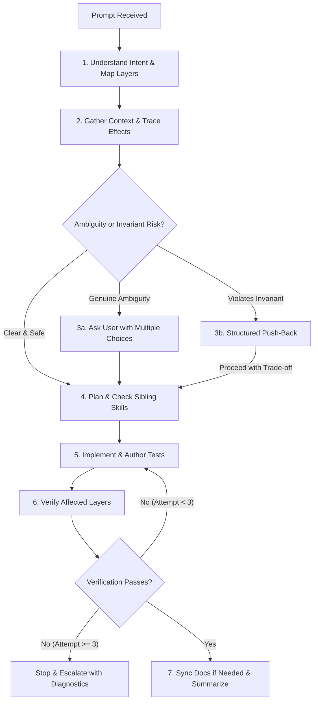

# Build Skill (Prompt-to-Implementation)

Use this workflow to take any ZAP coding requirement—feature, bug fix, refactor, or infra change—from initial prompt to verified, cleanly documented completion.

---

## Proportional Sizing (Match Ceremony to Risk)

Not every task needs the same overhead. Treating a 3-line bug fix like a new subsystem wastes turns, while skipping contract checks on a cross-layer feature risks breaking production invariants. Choose the lightest track that still protects safety:

| Track | When It Applies | Workflow |
|---|---|---|
| **Fast Path** | Isolated bug fix, small UI tweak, or single-module change with no schema, API, or sandbox impact | Inspect affected files & tests -> fix + add regression test -> run targeted `pytest` / `next build` -> brief summary |
| **Standard Flow** | Multi-file feature, new endpoint/UI view, or behavior change across modules | Full Steps 1–7 below, including `references/zap-invariants.md` check and `verify_build.sh` |
| **High-Risk / Cross-Boundary** | Schema changes, breaking API contracts, Cloud Tasks/executor lifecycle, hidden-test masking, or scaling infra | Full Steps 1–7 + trace second-order effects across `ZAP-BE`, `ZAP-FE`, and `docs/` + explicit push-back/clarification before editing |

---

## Core Workflow



---

## Step-by-Step Guide

### Step 1: Understand Intent & Map Affected Layers
Pinpoint what needs to change and which subsystems are involved:
- **Frontend (`ZAP-FE`)**: Next.js 15 App Router pages (`src/app/`), UI components (`src/components/`), API clients (`src/services/`), navigation config (`src/config/tabs.ts`), shared types (`src/types/`), in-browser load-test runner (`src/lib/load-test/`).
- **Backend API (`ZAP-BE/app`)**: FastAPI domain packages (`questions`, `submissions`, `contests`, `mcq`, `admin`, `activity`, `auth`, `compiler`, `db`, `config.py`).
- **Compiler & Execution (`ZAP-BE/executor`)**: Sandboxed language runners, auto-harness, judge engine, and Cloud Tasks worker (`core`, `judge`, `languages`, `sandbox`, `tasks`, `worker`).
- **Infrastructure & CI (`infra/`, `.github/workflows/`)**: Scaling profiles (`infra/profiles/*.env`), switcher script (`infra/scripts/switch-scaling.sh`), and `ci.yml`.
- **Tests (`ZAP-BE/tests`)** & **Docs (`context/`, `docs/`)**.

### Step 2: Gather Context & Trace Second-Order Effects
Before editing, inspect the code and contracts you touch so you understand *why* existing logic exists (Chesterton's Fence) and what downstream consumers depend on it:
1. Read only the relevant files in `context/` (index at `context/README.md`: architecture `02`, code standards `03`, workflow rules `04`, UI tokens `05`, ADRs `06`) and `docs/` (`docs/README.md`).
2. Whenever touching backend endpoints, MongoDB projections/schemas, submissions, contests, executor code, frontend API services, or scaling profiles, read [`references/zap-invariants.md`](references/zap-invariants.md) so hard-won production guardrails (loose coupling, DB-level hidden test sanitization, `X-ZAP-ENV` routing, 5s polling latch, 4/min rate limit, 10-item pagination) stay intact.
3. Trace callers, Pydantic/TypeScript schemas, existing tests, and runtime config (`ZAP-BE/app/config.py`, `ZAP-FE/src/services/environment.ts`).

### Step 3: Gated Clarification & Principled Push-Back
Guessing wrong on ambiguous requirements or irreversible changes costs far more than pausing to confirm, whereas asking trivial questions that can be read from the codebase slows the user down:
- **Clarify only when genuinely needed**: Ask only when requirements have conflicting interpretations, significant UX/architectural trade-offs, or irreversible effects (dropping/mutating persisted data, breaking public APIs). Always present concrete multiple-choice options (e.g., via `ask_question`).
- **Push back on invariant violations**: If a requested approach threatens a core invariant, breaks backward compatibility, bypasses validation/masking, or skips test coverage, present the trade-off clearly using `context/04-workflow-rules.md`'s format:
  ```text
  PRINCIPLE CONCERN: [Specific invariant or engineering standard violated]
  OBSERVATION:       [Concrete conflict, smell, or coupling identified]
  RISK:              [Failure mode, security exposure, or blast radius]
  SUGGESTION:        [Simpler or safer decoupled alternative]
  ```
  If the operator acknowledges the risk and asks to proceed anyway, implement cleanly and document why with `# TRADEOFF: ...` (Python) or `// TRADEOFF: ...` (TypeScript).

### Step 4: Formulate Plan & Coordinate Sibling Skills
Outline a concise plan covering affected files, schema/contract impact, new or updated tests, and exact verification commands. Where another installed skill specializes in part of the task, combine them rather than improvising:
- **`design-taste-frontend`**: Pair with `build` for major visual polish, landing pages, or aesthetic overhauls in `ZAP-FE`.
- **`universal-website-operator`**: Use alongside `build` after `ZAP-FE` changes that alter UI/UX or client state, to verify live rendering, console/network logs, and responsive viewports (routing test sessions via `X-ZAP-ENV: qa`).
- **`project-operations` (`zap-ops`)**: Use when debugging or validating live MongoDB Atlas state, Cloud Run logs, Cloud Tasks queues, or GitHub CI runs.

### Step 5: Implement & Author Tests
Write minimal, explicit, type-safe changes adhering to `context/03-code-standards.md`:
- **Defend boundaries**: Validate inputs with Pydantic v2 / TypeScript interfaces, fail fast with actionable errors (no silent `except: pass` or `catch {}`), use context managers and explicit timeouts, and keep MongoDB changes additive.
- **Avoid premature abstraction**: Follow the Rule of Three before extracting shared wrappers; keep presentation components clean and business logic in domain services.
- **Comment the why, preserve context**: Explain non-obvious rationale or constraints in comments, and preserve unrelated existing comments and docstrings.
- **Write tests with the code**:
  - *Bug fixes*: Add a regression test that reproduces the root failure mode and verifies the fix.
  - *Features/refactors*: Cover critical invariants, boundary inputs, and failure modes—testing observable outputs, state transitions, and API payloads rather than internal mock call order.

### Step 6: Verify & Capped Recovery
Run fast targeted checks while iterating, then run full verification for every affected layer after your final edit:
- **Composite verification** (runs backend `pytest`, frontend `next build`, and merge-conflict check):
  ```bash
  bash .agents/skills/build/scripts/verify_build.sh
  ```
  Useful flags: `--backend` (pytest only), `--frontend` (`next build` only), `--lint` (adds frontend lint/typecheck), `--fast` (`pytest -q --tb=short`).
- **Direct layer commands**:
  - Backend: `.venv/bin/pytest -v` (or `.venv/bin/pytest -v ZAP-BE/tests/<file>.py` during iteration)
  - Frontend: `npm run build --workspace=ZAP-FE`
- **Live UI note**: `next build` proves TypeScript types and bundling, not runtime DOM behavior. For interactive `ZAP-FE` changes, verify in a live browser (`universal-website-operator`) or note explicitly if browser verification wasn't run.

**Capped Iteration Guardrail (Max 2–3 Attempts)**:
If verification fails repeatedly, blindly looping wastes context and risks compounding errors. After **2 to 3 failed fix-and-verify cycles**, stop editing, document the exact error traces, root-cause hypotheses, and modified files, and ask the user for guidance.

### Step 7: Sync Documentation & Deliver Summary
- **Update docs only when behavior, contracts, or milestones changed** (skip doc churn for internal-only bug fixes):
  - Changes to submission flow, polling latches, Cloud Tasks, atomic leases, or sandbox execution -> update `docs/architecture/compiler-request-lifecycle.md` (required by `AGENTS.md`).
  - Schema, API, setup, or scaling profile changes -> update the matching doc under `docs/` and record significant architectural decisions in `context/06-progress-tracker.md`.
- **Report truthfully**: Summarize modified files, key behavioral changes, any doc updates, and the exact verification commands/outcomes observed after the final edit.
