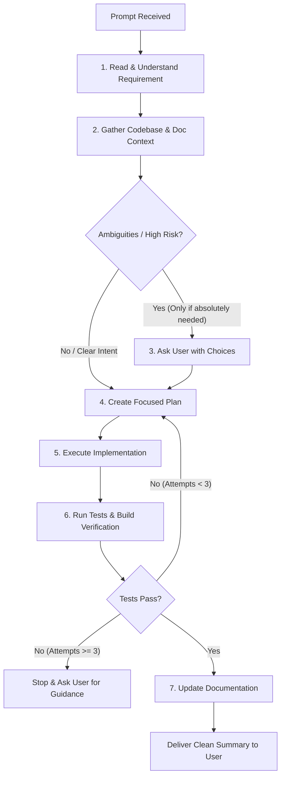

# Build Skill (Prompt-to-Implementation)

Use this skill whenever you receive a feature request, bug fix, or coding requirement directly in user prompts.

---

## 🔄 Core Workflow



---

## 📋 Step-by-Step Instructions

### Step 1: Read & Understand Requirement
- Identify what needs to be built, fixed, or modified.
- Determine affected layers:
  - **Frontend (`ZAP-FE`)**: Next.js, React, Tailwind CSS, Monaco editor, student / faculty flows.
  - **Backend API (`ZAP-BE/app`)**: FastAPI, Question CRUD, Submissions, Auth.
  - **Compiler & Execution (`ZAP-BE/executor`)**: Harness, Sandbox, JudgeEngine, Runner.
  - **Infrastructure & Pipeline**: Google Cloud Tasks, Cloud Run, MongoDB Atlas, GitHub Actions.

### Step 2: Context Gathering
- Inspect existing documentation in [`docs/`](file:///Users/apilav068@apac.comcast.com/zap/docs) to understand architectural boundaries and data contracts.
- Inspect active code and existing unit/integration tests covering the area.
- Verify active environment settings in `ZAP-BE/app/config.py` and `ZAP-FE/src/services/environment.ts`.

### Step 3: Clarify (Strictly Gated)
- **Rule**: Do NOT prompt the user with trivial questions that can be deduced from the codebase.
- **When to ask**: ONLY when requirements are genuinely ambiguous, conflicting, or present major architectural trade-offs.
- **How to ask**: Always provide concrete multiple-choice options (e.g. using `ask_question`) so the user can easily choose.

### Step 4: Plan
- Formulate a concise, bulleted implementation plan.
- Respect the **loose coupling rule**:
  - The Question management system and the Compiler/Execution engine must remain loosely coupled.
  - No question-specific business logic inside the compiler or runners.

### Step 5: Execute Implementation
- Write clean, type-safe, minimal code.
- Avoid introducing unnecessary dependencies or bloating files.
- Preserve existing docstrings, comments, and conventions.

### Step 6: Test & Verify
- Run backend verification:
  ```bash
  .venv/bin/pytest -v
  ```
- Run frontend verification:
  ```bash
  npm run build --workspace=ZAP-FE
  ```
- Or run the composite build verification script:
  ```bash
  .agents/skills/build/scripts/verify_build.sh
  ```

### Step 7: Capped Iteration Guardrail (Max 2-3 Iterations)
- If tests or builds fail:
  - Analyze the error trace.
  - Adjust the code and re-test.
  - **CRITICAL**: Do NOT repeat in an endless loop. After **2 to 3 failed attempts**, STOP, document the exact failure and diagnostic findings, and ask the user for clarification or guidance.

### Step 8: Document
- Keep documentation in sync: update relevant markdown files under `docs/` or API contracts if interfaces changed.
- Provide a concise, high-signal summary of what was completed to the user.
