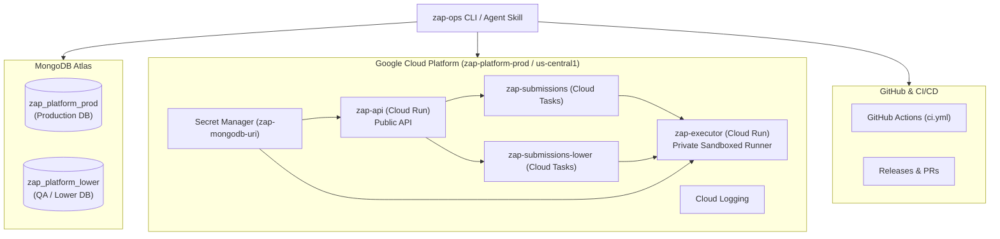

# Cloud & Database Operations Skill (`cloud-ops`)

Use this skill whenever you need to interact with, query, diagnose, or troubleshoot the ZAP cloud ecosystem:
1. **MongoDB Atlas**: Databases `zap_platform_prod` (production) and `zap_platform_lower` (QA/staging).
2. **Google Cloud Platform (GCP)**: Cloud Run (`zap-api`, `zap-executor`), Cloud Tasks (`zap-submissions`, `zap-submissions-lower`), Secret Manager (`zap-mongodb-uri`), and Cloud Logging.
3. **GitHub & CI/CD**: Workflow runs, deployment gates, pull requests, and repository metadata via GitHub CLI.

---

## 🏛️ Infrastructure Topology



---

## 🛡️ Safety Invariants & Guardrails

1. **Read-Only Defaults**: Queries, schema inspections, count checks, and log readings are strictly non-destructive.
2. **Production Safeguards**:
   - Write or delete operations on `zap_platform_prod` are hard-locked and disallowed through standard operational commands.
   - Cloud Tasks production queue (`zap-submissions`) flow changes require explicit `--confirm-prod` flag.
3. **Sensitive Credential Protection**:
   - Connection strings and credentials in `.env` (`MONGO_URI`, `GIT_TOKEN`) are automatically loaded without echoing plaintext secrets to terminal stdout or log files.
4. **Environment Isolation**:
   - Queries default to `--env prod` for inspection, or `--env lower` for QA testing.
   - Sync operations (`mongo sync-to-lower`) are strictly one-way from production to lower database.

---

## 🛠️ Unified CLI Tool: `zap-ops`

The skill includes a dedicated, zero-setup CLI tool located at:
```bash
.agents/skills/cloud-ops/scripts/zap-ops
# Or directly via Python:
.venv/bin/python .agents/skills/cloud-ops/scripts/zap_ops.py <subcommand>
```

### 1. Platform Health Check (`doctor` / `status`)

Runs an instant, comprehensive health check across MongoDB Atlas, GCP services, and GitHub CI/CD:
```bash
.agents/skills/cloud-ops/scripts/zap-ops doctor
```

Output:
```text
=======================================================
       ZAP PLATFORM INFRASTRUCTURE & DATA HEALTH       
=======================================================

1. MongoDB Atlas:
  ✓ Connection Ping: 1334.2ms (ok=1)
  ✓ Production (zap_platform_prod): 8 collections, 4,720 total documents
  ✓ QA/Lower (zap_platform_lower): 6 collections, 12 total documents

2. Google Cloud Platform (GCP):
  Target Project: zap-platform-prod (us-central1)
  ✓ READY Cloud Run 'zap-api': https://zap-api-myzbampa3q-uc.a.run.app
  ✓ READY Cloud Run 'zap-executor': https://zap-executor-myzbampa3q-uc.a.run.app
  ✓ RUNNING Cloud Tasks 'zap-submissions'
  ⚠ PAUSED Cloud Tasks 'zap-submissions-lower'

3. GitHub CI/CD:
  ✓ Authenticated as GitHub user: alendnl
  Latest CI: [✓ success] ZAP CI on 'main' (https://github.com/alendnl/zap/actions/runs/...)
=======================================================
```

---

### 2. MongoDB Operations (`mongo`)

Target either `--env prod` (`zap_platform_prod`) or `--env lower` (`zap_platform_lower`).

#### Test Connection & Latency
```bash
.agents/skills/cloud-ops/scripts/zap-ops mongo ping
```

#### List Collections & Document Counts
```bash
.agents/skills/cloud-ops/scripts/zap-ops mongo list --env prod
.agents/skills/cloud-ops/scripts/zap-ops mongo list --env lower
```

#### Compare Document Counts Across Environments
```bash
.agents/skills/cloud-ops/scripts/zap-ops mongo count
```

#### Query Documents
Filter documents using JSON, project specific fields, sort, and display as a formatted table or JSON:
```bash
# Query questions in production (table format):
.agents/skills/cloud-ops/scripts/zap-ops mongo query --env prod -c questions --fields slug,title,difficulty --limit 5

# Query recent failed or queued submissions:
.agents/skills/cloud-ops/scripts/zap-ops mongo query --env prod -c submissions \
  --filter '{"status": "QUEUED"}' \
  --fields id,userId,questionId,status,createdAt \
  --sort "createdAt:-1" \
  --limit 10

# Return raw JSON output:
.agents/skills/cloud-ops/scripts/zap-ops mongo query --env prod -c questions \
  --filter '{"slug": "two-sum-basics"}' \
  --format json
```

#### Get Single Document
Retrieve by ObjectId, string ID, slug, or email:
```bash
.agents/skills/cloud-ops/scripts/zap-ops mongo get --env prod -c questions two-sum-basics
.agents/skills/cloud-ops/scripts/zap-ops mongo get --env prod -c users student@example.com
```

#### Infer Document Schema
Analyzes sampled documents and reports field names, data types, and sample values:
```bash
.agents/skills/cloud-ops/scripts/zap-ops mongo schema --env prod -c questions
.agents/skills/cloud-ops/scripts/zap-ops mongo schema --env prod -c submissions
```

#### Inspect Indexes
Displays all defined indexes, keys, and uniqueness flags:
```bash
.agents/skills/cloud-ops/scripts/zap-ops mongo indexes --env prod -c submissions
```

#### Safe One-Way Sync from Production to Lower (QA)
Populate lower QA environment with questions or contests from production:
```bash
.agents/skills/cloud-ops/scripts/zap-ops mongo sync-to-lower -c questions --limit 10
.agents/skills/cloud-ops/scripts/zap-ops mongo sync-to-lower -c mcq_questions
```

---

### 3. Google Cloud Platform Operations (`gcp`)

Manages and monitors serverless Cloud Run services, Cloud Tasks queues, logs, and secrets in GCP project `zap-platform-prod`.

#### Inspect Cloud Run Services
Checks status, readiness, public/private URLs, and active revision:
```bash
.agents/skills/cloud-ops/scripts/zap-ops gcp services
```

#### Inspect Cloud Tasks Queues
Checks queue state (RUNNING / PAUSED), dispatch rates, and concurrency limits:
```bash
.agents/skills/cloud-ops/scripts/zap-ops gcp tasks
```

#### Control Queue State (Pause / Resume)
Useful for maintenance or isolating queues during tests:
```bash
# Pause lower queue:
.agents/skills/cloud-ops/scripts/zap-ops gcp queue-state zap-submissions-lower pause

# Resume lower queue:
.agents/skills/cloud-ops/scripts/zap-ops gcp queue-state zap-submissions-lower resume
```

#### Inspect Recent Cloud Run Container Logs
Query logs filtered by service, severity, or keyword:
```bash
# Get recent error logs for zap-api:
.agents/skills/cloud-ops/scripts/zap-ops gcp logs --service api --severity ERROR --limit 20

# Get recent logs for zap-executor:
.agents/skills/cloud-ops/scripts/zap-ops gcp logs --service executor --limit 25

# Search logs for a specific submission ID or error keyword:
.agents/skills/cloud-ops/scripts/zap-ops gcp logs --service api --search "500 Internal" --limit 15
```

#### Inspect Secret Manager Secrets
Lists managed secrets and replication status without exposing secret values:
```bash
.agents/skills/cloud-ops/scripts/zap-ops gcp secrets
```

---

### 4. GitHub CI/CD Operations (`github`)

Inspects GitHub Actions workflow runs, CI deployment gates, and repository status using `gh` authenticated with `GIT_TOKEN`.

#### List Recent CI/CD Workflow Runs
```bash
.agents/skills/cloud-ops/scripts/zap-ops github runs --limit 5
.agents/skills/cloud-ops/scripts/zap-ops github runs --workflow ci.yml --limit 3
```

#### View Workflow Run Details & Failure Logs
```bash
# Inspect a specific run:
.agents/skills/cloud-ops/scripts/zap-ops github view <RUN_ID>

# Directly display failed step logs:
.agents/skills/cloud-ops/scripts/zap-ops github view <RUN_ID> --failed-logs
```

#### View Repository Overview
```bash
.agents/skills/cloud-ops/scripts/zap-ops github status
```

---

## 📖 Operational Playbooks & Common Scenarios

### Scenario 1: Diagnosing a "Stuck Submission" or Compiler Issue
1. Run `.agents/skills/cloud-ops/scripts/zap-ops doctor` to check overall platform health.
2. Query the submission in MongoDB:
   ```bash
   .agents/skills/cloud-ops/scripts/zap-ops mongo get --env prod -c submissions <SUBMISSION_ID>
   ```
3. Check Cloud Tasks queue states:
   ```bash
   .agents/skills/cloud-ops/scripts/zap-ops gcp tasks
   ```
4. Query recent `zap-executor` logs for execution errors:
   ```bash
   .agents/skills/cloud-ops/scripts/zap-ops gcp logs --service executor --search "<SUBMISSION_ID>" --limit 10
   ```

### Scenario 2: QA Environment Testing Setup
When testing new features in QA (`X-ZAP-ENV: qa`):
1. Check collection counts in the lower database:
   ```bash
   .agents/skills/cloud-ops/scripts/zap-ops mongo list --env lower
   ```
2. If question data is missing in lower environment, safely sync from production:
   ```bash
   .agents/skills/cloud-ops/scripts/zap-ops mongo sync-to-lower -c questions --limit 10
   .agents/skills/cloud-ops/scripts/zap-ops mongo sync-to-lower -c mcq_questions
   ```
3. Ensure the QA queue is running:
   ```bash
   .agents/skills/cloud-ops/scripts/zap-ops gcp queue-state zap-submissions-lower resume
   ```

### Scenario 3: Investigating Deployment Failures
1. List recent GitHub Actions runs:
   ```bash
   .agents/skills/cloud-ops/scripts/zap-ops github runs --limit 3
   ```
2. If the deployment failed, inspect the error output:
   ```bash
   .agents/skills/cloud-ops/scripts/zap-ops github view <RUN_ID> --failed-logs
   ```
3. Verify Cloud Run revision status:
   ```bash
   .agents/skills/cloud-ops/scripts/zap-ops gcp services
   ```
