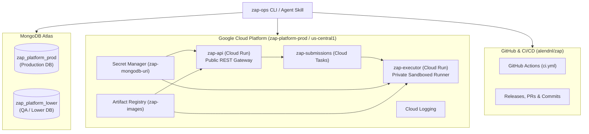
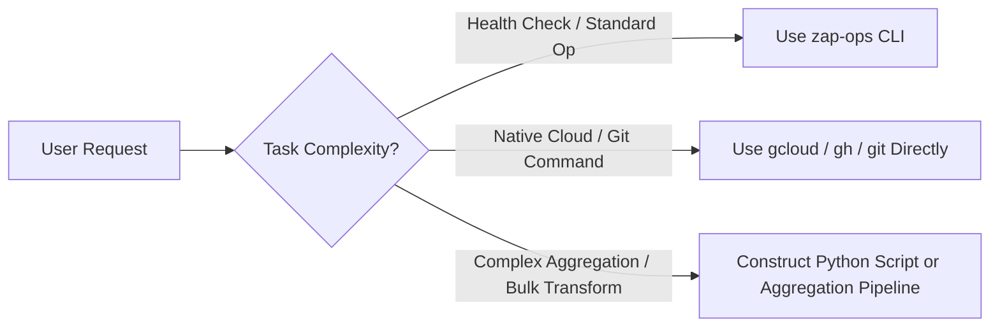

# Unified Cloud & Repository Operations Skill (`project-operations`)

Use this skill whenever you need to inspect, query, manage, diagnose, troubleshoot, deploy, or analyze any part of the ZAP platform and its supporting infrastructure:
1. **MongoDB Atlas**: Databases `zap_platform_prod` (production) and `zap_platform_lower` (QA/staging).
2. **Google Cloud Platform (GCP)**: Project `zap-platform-prod` (`us-central1`), Cloud Run (`zap-api`, `zap-executor`), Cloud Tasks (`zap-submissions`), Secret Manager (`zap-mongodb-uri`), Artifact Registry (`zap-images`), and Cloud Logging.
3. **Git & GitHub CI/CD**: Repository `alendnl/zap`, GitHub Actions (`ci.yml`), deployment status verification, PR inspection, and commit tracking.
4. **Cross-System Intelligence**: Correlating GCP container logs, MongoDB submission states, Git commits, and application code to diagnose issues end-to-end.

---

## 🏛️ Infrastructure Topology & Architectural Invariants



### 5 Strict Architectural Invariants
1. **Loose Coupling Boundary**: Question management (`ZAP-BE/app/questions`) is strictly decoupled from the execution engine (`ZAP-BE/executor`). The executor never knows question IDs or contest rules.
2. **Untrusted Code Isolation**: Student code executes **only** inside sandboxed worker processes in `zap-executor` with strict CPU, memory, and wall-clock limits.
3. **Single Deployment, Multi-Tenant Runtime Routing**: Compute is unified on Cloud Run. Routing to `zap_platform_prod` vs `zap_platform_lower` is dynamic via the `X-ZAP-ENV` header (`production` vs `qa`).
4. **Asynchronous Execution Pipeline**: Formal submissions are recorded as `QUEUED`, enqueued to Cloud Tasks, executed asynchronously by `zap-executor`, and polled by the frontend.
5. **Test Case Masking**: Test cases marked `visibility: HIDDEN` must never have inputs, outputs, or error traces exposed to public API callers.

---

## 🛠️ Unified CLI Tool: `zap-ops`

The primary executable CLI tool is located at:
```bash
.agents/skills/project-operations/scripts/zap-ops <command> [options]
# Or directly via Python:
.venv/bin/python .agents/skills/project-operations/scripts/zap_ops.py <command> [options]
```

---

## 🧭 Dynamic Tool Discovery & Execution Strategy

Follow this hybrid execution strategy:



1. **Native CLI Tools**: Use native `git` (local read-only/commit commands) and `gcloud` for standard local/cloud commands, **but never use SSH (`git@github.com*`) or unauthenticated remote `git` commands** — route all remote Git (`push`, `pull`, `fetch`) and `gh` operations through `zap-ops` so `GIT_TOKEN` from `.env` is used over HTTPS.
2. **`zap-ops` Unified CLI**: Use for multi-step workflows, diagnostic checks (`doctor`), database querying/schema inspection, queue management, log inspection, deployment sync, and HTTPS-authenticated Git/GitHub operations.
3. **Python Scripts**: Use `.venv/bin/python` with `pymongo` for complex aggregations, bulk migrations, or structured exports when single-line CLI commands are insufficient.
4. **Automatic Authentication**:
   - MongoDB: Loads `MONGO_URI` from `.env` using `ReadPreference.PRIMARY_PREFERRED`.
   - Git & GitHub (HTTPS Only): Maps `GIT_TOKEN` in `.env` to `GH_TOKEN` for `gh` and authenticates remote `git` operations over `https://github.com/alendnl/zap.git` via temporary `GIT_ASKPASS` + `-c credential.helper=` (ignoring SSH and macOS Keychain work accounts).
   - GCP: Uses local `gcloud` authenticated profile targeting project `zap-platform-prod`.

---

## 📋 Operational Command Reference

### 1. Platform Health Check (`doctor` / `status`)
Runs an instant, comprehensive health check across MongoDB Atlas, GCP services, and GitHub CI/CD:
```bash
.agents/skills/project-operations/scripts/zap-ops doctor
```

---

### 2. MongoDB Operations (`mongo`)
Target either `--env prod` (`zap_platform_prod`) or `--env lower` (`zap_platform_lower`).

#### Test Connection & Latency
```bash
.agents/skills/project-operations/scripts/zap-ops mongo ping
```

#### List Collections & Document Counts
```bash
.agents/skills/project-operations/scripts/zap-ops mongo list --env prod
.agents/skills/project-operations/scripts/zap-ops mongo list --env lower
```

#### Compare Document Counts Across Environments
```bash
.agents/skills/project-operations/scripts/zap-ops mongo count
```

#### Query Documents
```bash
# Table format with field projection:
.agents/skills/project-operations/scripts/zap-ops mongo query --env prod -c questions --fields slug,title,difficulty --limit 5

# JSON format with filter and sort:
.agents/skills/project-operations/scripts/zap-ops mongo query --env prod -c submissions \
  --filter '{"status": "QUEUED"}' \
  --fields id,userId,questionId,status,createdAt \
  --sort "createdAt:-1" \
  --format json \
  --limit 10
```

#### Retrieve Single Document
```bash
.agents/skills/project-operations/scripts/zap-ops mongo get --env prod -c questions two-sum-basics
.agents/skills/project-operations/scripts/zap-ops mongo get --env prod -c users student@example.com
```

#### Infer Document Schema
```bash
.agents/skills/project-operations/scripts/zap-ops mongo schema --env prod -c questions
.agents/skills/project-operations/scripts/zap-ops mongo schema --env prod -c submissions
```

#### Inspect & Ensure Indexes
```bash
# Inspect defined indexes:
.agents/skills/project-operations/scripts/zap-ops mongo indexes --env prod -c submissions

# Ensure all production indexes exist:
.agents/skills/project-operations/scripts/zap-ops mongo ensure-indexes --env prod
```

#### Execute Aggregation Pipeline
```bash
.agents/skills/project-operations/scripts/zap-ops mongo aggregate --env prod -c submissions \
  --pipeline '[{"$group": {"_id": "$status", "count": {"$sum": 1}}}]'
```

#### Data Import, Export & Backup
```bash
# Export to JSON:
.agents/skills/project-operations/scripts/zap-ops mongo export --env prod -c questions -o ./exports/questions.json

# Export to CSV with projection:
.agents/skills/project-operations/scripts/zap-ops mongo export --env prod -c submissions \
  --fields id,userId,userEmail,verdict,createdAt -o ./exports/submissions.csv --limit 500

# Import / Upsert from JSON:
.agents/skills/project-operations/scripts/zap-ops mongo import --env lower -c questions -i ./exports/questions.json --upsert

# Full database backup to directory:
.agents/skills/project-operations/scripts/zap-ops mongo backup --env lower -o ./backups/qa_snapshot

# One-way sync from production to lower (QA):
.agents/skills/project-operations/scripts/zap-ops mongo sync-to-lower -c questions --limit 10
```

---

### 3. Google Cloud Platform Operations (`gcp`)

#### Inspect Cloud Run Services
```bash
.agents/skills/project-operations/scripts/zap-ops gcp services
```

#### Inspect Cloud Tasks Queues & Control States
```bash
# Check queue status:
.agents/skills/project-operations/scripts/zap-ops gcp tasks

# Pause or resume queue:
.agents/skills/project-operations/scripts/zap-ops gcp queue-state zap-submissions pause --confirm-prod
.agents/skills/project-operations/scripts/zap-ops gcp queue-state zap-submissions resume --confirm-prod
```

#### Query Container Logs
```bash
# Error logs for zap-api:
.agents/skills/project-operations/scripts/zap-ops gcp logs --service api --severity ERROR --limit 20

# Search logs for submission ID:
.agents/skills/project-operations/scripts/zap-ops gcp logs --service executor --search "<SUBMISSION_ID>" --limit 15
```

#### Scale Cloud Run Capacity
```bash
.agents/skills/project-operations/scripts/zap-ops gcp scale --service executor --min-instances 2 --max-instances 20
```

#### Check Deployment Revision Sync
```bash
.agents/skills/project-operations/scripts/zap-ops gcp deploy-status
```

---

### 4. Git & GitHub Operations (`git` & `github`)

#### List & Inspect CI/CD Runs
```bash
# List recent CI runs:
.agents/skills/project-operations/scripts/zap-ops github runs --limit 5

# View run details and failure logs:
.agents/skills/project-operations/scripts/zap-ops github view <RUN_ID> --failed-logs
```

#### Trigger Workflow Dispatch
```bash
.agents/skills/project-operations/scripts/zap-ops github trigger --workflow ci.yml --ref main --target backend
```

#### Git Status, History & HTTPS Token Operations
```bash
.agents/skills/project-operations/scripts/zap-ops git status
.agents/skills/project-operations/scripts/zap-ops git recent -n 5
.agents/skills/project-operations/scripts/zap-ops git fetch --all
.agents/skills/project-operations/scripts/zap-ops git pull origin main
.agents/skills/project-operations/scripts/zap-ops git push origin main
```

---

## 🔗 Cross-System Correlated Workflows

When investigating issues or fulfilling complex requests, correlate information across systems rather than checking them in isolation:

| Scenario | Cross-System Workflow | Reference Playbook |
|---|---|---|
| **Incident Debugging** | Correlate `zap-ops gcp logs` ➔ MongoDB submission record ➔ Git commit diff ➔ Source code root cause ➔ Fix & test | [Playbook 1](./references/cross-system-playbooks.md#playbook-1-production-incident--compiler-failure-debugging) |
| **Data Analysis** | Schema discovery ➔ Mongo aggregation pipeline ➔ JSON/CSV export ➔ Formatted summary | [Playbook 2](./references/cross-system-playbooks.md#playbook-2-complex-database-analysis--reporting) |
| **Capacity Sizing** | Cloud Run status ➔ Scaling configuration update ➔ Health check validation | [Playbook 3](./references/cross-system-playbooks.md#playbook-3-infrastructure-scaling--capacity-adjustment) |
| **Deploy Sync** | Git HEAD commit SHA ➔ Cloud Run image tags ➔ GitHub CI run status | [Playbook 4](./references/cross-system-playbooks.md#playbook-4-deployment-synchronization--verification) |

---

## 🛡️ Permissions & Execution Behavior

1. **Authorized Direct Execution**: The operator explicitly authorizes Gemini to perform requested database reads/writes, GCP configurations, scaling, deployments, and Git operations. Execute explicitly requested actions directly without introducing unnecessary approval roadblocks.
2. **No Unrequested Destruction**: Never delete databases, drop collections, or purge resources unless explicitly instructed.
3. **Zero Plaintext Secrets**: Never echo credentials, tokens, or connection strings to stdout or commit them to git.
4. **Environment Safety**: Always confirm the target environment (`--env prod` vs `--env lower`) before executing write operations.

---

## 📚 Supporting References

- [`references/mongodb-reference.md`](./references/mongodb-reference.md): Collections, schema types, production indexes, and aggregation cookbook.
- [`references/gcp-reference.md`](./references/gcp-reference.md): Cloud Run sizing, Cloud Tasks queue configs, IAM bindings, and Cloud Logging syntax.
- [`references/git-github-reference.md`](./references/git-github-reference.md): GitHub CI/CD mechanics, workflow dispatch, and CLI integration.
- [`references/cross-system-playbooks.md`](./references/cross-system-playbooks.md): Step-by-step incident debugging, data analysis, scaling, and deploy sync playbooks.
