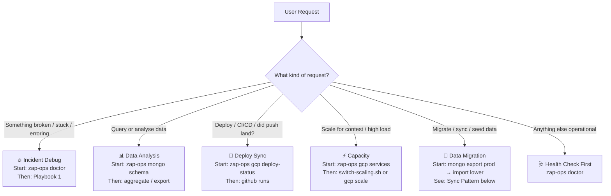
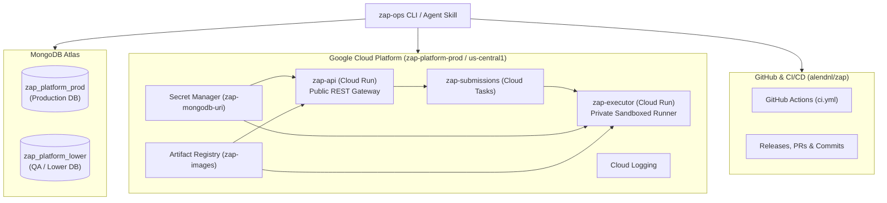

# Unified Cloud & Repository Operations Skill (`project-operations`)

This skill covers every operational workflow for the ZAP platform. When in doubt, **activate it and start with `zap-ops doctor`** — that single command checks MongoDB Atlas, GCP services, and GitHub CI/CD in one shot.

**Reference files** — read them on demand, don't load all upfront:
- [`mongodb-reference.md`](./references/mongodb-reference.md) — collection schemas, production indexes, aggregation cookbook
- [`gcp-reference.md`](./references/gcp-reference.md) — Cloud Run sizing, Cloud Tasks topology, IAM matrix, scaling profiles
- [`git-github-reference.md`](./references/git-github-reference.md) — GitHub Actions path filtering, CI/CD mechanics, `gh` CLI usage
- [`cross-system-playbooks.md`](./references/cross-system-playbooks.md) — step-by-step incident debugging, data analysis, scaling, and deploy-sync playbooks

---

## 🧭 Start Here: Request Triage



---

## 🏛️ Infrastructure Topology



### 5 Architectural Invariants (never violate)
| # | Invariant |
|---|---|
| 1 | **Loose Coupling**: `ZAP-BE/app/questions` is strictly decoupled from `ZAP-BE/executor`. The executor never knows question IDs or contest rules. |
| 2 | **Sandbox Isolation**: Student code runs **only** inside sandboxed worker processes in `zap-executor` with strict CPU/memory/wall-clock limits. |
| 3 | **Multi-Tenant Routing**: `X-ZAP-ENV` header (`production` vs `qa`) is the sole mechanism routing a request to `zap_platform_prod` vs `zap_platform_lower`. |
| 4 | **Async Pipeline**: Submissions are `QUEUED` → Cloud Tasks → `zap-executor` asynchronously; never call the executor directly. |
| 5 | **Hidden Test Cases**: Test cases with `visibility: HIDDEN` must **never** expose inputs, outputs, or error traces to public API callers. |

---

## 🛠️ CLI Tool: `zap-ops`

```bash
# Preferred (executable wrapper):
.agents/skills/project-operations/scripts/zap-ops <command> [options]

# Fallback (direct Python):
.venv/bin/python .agents/skills/project-operations/scripts/zap_ops.py <command> [options]
```

**Tool selection strategy:**

| Scenario | Use |
|---|---|
| Health check, standard query, standard op | `zap-ops` CLI |
| Native cloud inspection (IAM, billing, raw metrics) | `gcloud` / `gh` / `git` directly |
| Complex aggregation, bulk transform, structured export | Python script with `pymongo` via `.venv/bin/python` |
| All remote Git (`push`, `pull`, `fetch`) and all `gh` commands | **Always** via `zap-ops` (injects `GIT_TOKEN` from `.env` over HTTPS) |

---

## 📋 Command Reference

### Health Check
```bash
zap-ops doctor                        # Full platform health: MongoDB + GCP + GitHub
```

---

### MongoDB (`mongo`)

```bash
# Connectivity
zap-ops mongo ping

# Explore collections
zap-ops mongo list --env prod          # list all collections + document counts
zap-ops mongo count                    # compare counts across prod vs lower
zap-ops mongo schema --env prod -c questions
zap-ops mongo indexes --env prod -c submissions
zap-ops mongo ensure-indexes --env prod

# Query documents
zap-ops mongo query --env prod -c questions \
  --fields slug,title,difficulty --limit 5

zap-ops mongo query --env prod -c submissions \
  --filter '{"status": "QUEUED"}' \
  --fields id,userId,questionId,status,createdAt \
  --sort "createdAt:-1" --format json --limit 10

# Get single document (by slug, id, or email)
zap-ops mongo get --env prod -c questions two-sum-basics
zap-ops mongo get --env prod -c users student@example.com

# Aggregation
zap-ops mongo aggregate --env prod -c submissions \
  --pipeline '[{"$group": {"_id": "$status", "count": {"$sum": 1}}}]'

# Export / Import / Backup / Sync
zap-ops mongo export --env prod -c questions -o ./exports/questions.json
zap-ops mongo export --env prod -c submissions \
  --fields id,userId,userEmail,verdict,createdAt -o ./exports/submissions.csv --limit 500
zap-ops mongo import --env lower -c questions -i ./exports/questions.json --upsert
zap-ops mongo backup --env lower -o ./backups/qa_snapshot
zap-ops mongo sync-to-lower -c questions --limit 10   # one-way prod → lower
```

> **Data Migration Pattern** — to seed or refresh a QA collection from production:
> 1. Export from prod: `zap-ops mongo export --env prod -c <col> -o /tmp/<col>.json`
> 2. Upsert into lower: `zap-ops mongo import --env lower -c <col> -i /tmp/<col>.json --upsert`
> 3. Verify: `zap-ops mongo count` and spot-check with `zap-ops mongo query --env lower`

---

### GCP (`gcp`)

```bash
# Inspect services & queues
zap-ops gcp services                   # Cloud Run revision URLs, min/max instances, CPU/RAM
zap-ops gcp tasks                      # Cloud Tasks queue state, concurrency, backlog
zap-ops gcp secrets                    # List Secret Manager secrets (names only, never values)
zap-ops gcp deploy-status              # Compare deployed image tags to local Git HEAD SHA

# Logs
zap-ops gcp logs --service api --severity ERROR --limit 20
zap-ops gcp logs --service executor --search "<SUBMISSION_ID>" --limit 15

# Queue control
zap-ops gcp queue-state zap-submissions pause --confirm-prod
zap-ops gcp queue-state zap-submissions resume --confirm-prod

# Scaling (manual)
zap-ops gcp scale --service executor --min-instances 2 --max-instances 20
zap-ops gcp scale --service api --min-instances 2 --max-instances 15

# Scaling profiles (contest vs normal)
./infra/scripts/switch-scaling.sh contest   # pre-warms high-capacity contest mode
./infra/scripts/switch-scaling.sh normal    # returns to scale-to-zero day-to-day mode
```

> **Contest Scaling Checklist**: Before a large contest, run `zap-ops doctor`, then `switch-scaling.sh contest`, then `zap-ops gcp services` to verify the new min/max values took effect. See `gcp-reference.md §6` for exact resource targets.

---

### Git & GitHub (`git` / `github`)

```bash
# CI/CD inspection
zap-ops github runs --limit 5
zap-ops github view <RUN_ID> --failed-logs
zap-ops github trigger --workflow ci.yml --ref main --target backend   # or --target all / frontend

# Arbitrary gh commands (auto-authenticated with GIT_TOKEN)
zap-ops github exec pr list
zap-ops github exec release list

# Local Git
zap-ops git status
zap-ops git recent -n 5

# Authenticated remote Git (uses GIT_TOKEN from .env, bypasses SSH & OS keychain)
zap-ops git push origin main
zap-ops git pull origin main
zap-ops git fetch --all
zap-ops git exec ls-remote origin
```

> **CI path filtering**: pushes touching only `docs/**`, `.agents/**`, `*.md` skip test + deploy automatically. Only `ZAP-BE/**` triggers backend tests; only `ZAP-FE/**` triggers frontend tests. See `git-github-reference.md §2`.

---

## 🔗 Cross-System Correlated Workflows

Always correlate across systems rather than checking them in isolation. When you have a symptom, follow the matching playbook:

| Scenario | Quick Start | Full Playbook |
|---|---|---|
| Submission stuck / Internal Server Error | `zap-ops doctor` → `mongo get submissions <ID>` → `gcp logs` | [Playbook 1](./references/cross-system-playbooks.md#playbook-1-production-incident--compiler-failure-debugging) |
| Data analysis / ranking / reporting | `mongo schema` → `mongo aggregate` → export | [Playbook 2](./references/cross-system-playbooks.md#playbook-2-complex-database-analysis--reporting) |
| Scale up for contest | `gcp services` → `switch-scaling.sh contest` → verify | [Playbook 3](./references/cross-system-playbooks.md#playbook-3-infrastructure-scaling--capacity-adjustment) |
| "Did my push deploy?" | `gcp deploy-status` → `github runs` → trigger if needed | [Playbook 4](./references/cross-system-playbooks.md#playbook-4-deployment-synchronization--verification) |

---

## 🛡️ Permissions & Safety Rules

1. **Execute directly**: The operator authorizes all requested reads, writes, GCP configuration, scaling, and Git operations. Don't add unnecessary confirmation gates.
2. **No unrequested destruction**: Never drop collections, delete databases, or purge queues unless the user explicitly asks.
3. **Zero plaintext secrets**: Never echo credentials, tokens, or connection strings to stdout or commit to git.
4. **Environment safety**: Always confirm `--env prod` vs `--env lower` before any write operation.
5. **MongoDB fail-fast**: If `zap-ops mongo` or `pymongo` fails after 1–2 attempts (`ServerSelectionTimeoutError`, IP block, VPN/firewall):
   - **Stop and alert** — do not silently retry or switch to workarounds.
   - Tell the user the error and likely cause (IP whitelist / firewall), then offer:
     - *Retry* after they fix network access, **or**
     - *Workaround* via `zap-api` HTTPS endpoints / Cloud Logging (only if they confirm).
6. **GCP auth issues**: If `gcloud` commands fail with auth errors, tell the user to run `gcloud auth login` or `gcloud config set project zap-platform-prod` and try again — don't attempt undocumented workarounds.
7. **GitHub auth issues**: If `gh` or `zap-ops github` fails, confirm `GIT_TOKEN` is set in `.env` and not expired; never use SSH remotes or macOS Keychain work credentials.
