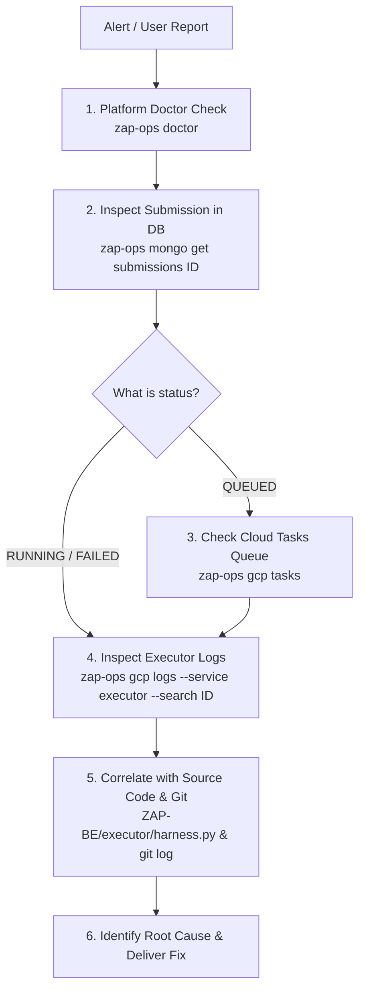
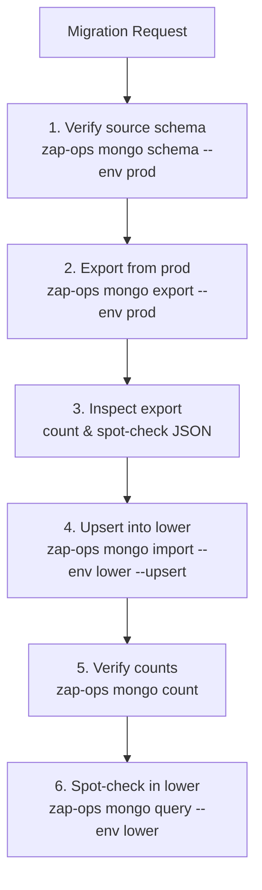

# Cross-System Operations Playbooks: ZAP Platform

This reference provides end-to-end operational playbooks that correlate findings across **GCP Cloud Run / Cloud Tasks**, **MongoDB Atlas**, **Git/GitHub**, and **Source Code**.

## Playbook Index
- [Playbook 1: Production Incident / Compiler Failure Debugging](#-playbook-1-production-incident--compiler-failure-debugging)
- [Playbook 2: Complex Database Analysis & Reporting](#-playbook-2-complex-database-analysis--reporting)
- [Playbook 3: Infrastructure Scaling & Capacity Adjustment](#-playbook-3-infrastructure-scaling--capacity-adjustment)
- [Playbook 4: Deployment Synchronization & Verification](#-playbook-4-deployment-synchronization--verification)
- [Playbook 5: Data Migration & Environment Seeding](#-playbook-5-data-migration--environment-seeding)

---

## 🏛️ Playbook 1: Production Incident & Compiler Failure Debugging

**Scenario**: A student or faculty member reports: *"My submission is stuck in RUNNING or failed with Internal Server Error."*



### Execution Steps:
1. **Run Full Health Check**:
   ```bash
   .agents/skills/project-operations/scripts/zap-ops doctor
   ```
   Check if MongoDB, Cloud Run services, or Cloud Tasks queues are paused or down.

2. **Retrieve the Submission Record**:
   ```bash
   .agents/skills/project-operations/scripts/zap-ops mongo get --env prod -c submissions <SUBMISSION_ID>
   ```
   Inspect `status`, `mode`, `language`, `createdAt`, and `errorMessage`.

3. **Check Cloud Tasks Queue Status**:
   ```bash
   .agents/skills/project-operations/scripts/zap-ops gcp tasks
   ```
   Ensure `zap-submissions` queue state is `RUNNING` and concurrency is not saturated.

4. **Query Container Logs in GCP Cloud Logging**:
   ```bash
   # Check zap-executor logs for the submission ID:
   .agents/skills/project-operations/scripts/zap-ops gcp logs --service executor --search "<SUBMISSION_ID>" --limit 15

   # Check zap-api error logs:
   .agents/skills/project-operations/scripts/zap-ops gcp logs --service api --severity ERROR --limit 15
   ```

5. **Correlate with Source Code & Commits**:
   - Inspect the language runner in `ZAP-BE/executor/runners/<language>.py` or the execution harness in `ZAP-BE/executor/harness.py`.
   - Check recent commits affecting that file using:
     ```bash
     git log -n 5 -p ZAP-BE/executor/runners/
     ```

6. **Formulate Solution & Verify**:
   - Run tests locally (`.venv/bin/pytest ZAP-BE/tests/`).
   - If a queue was paused, resume it:
     ```bash
     .agents/skills/project-operations/scripts/zap-ops gcp queue-state zap-submissions resume --confirm-prod
     ```

---

## 📊 Playbook 2: Complex Database Analysis & Reporting

**Scenario**: *"Analyze student performance across all colleges: calculate accuracy rate, total submissions, and export the top 50 candidates to CSV."*

### Execution Steps:
1. **Examine Document Schema**:
   ```bash
   .agents/skills/project-operations/scripts/zap-ops mongo schema --env prod -c users
   .agents/skills/project-operations/scripts/zap-ops mongo schema --env prod -c submissions
   ```

2. **Construct Aggregation Pipeline**:
   Build an aggregation that joins users with submission statistics:
   ```json
   [
     {"$match": {"mode": "SUBMIT", "status": "COMPLETED"}},
     {"$group": {
       "_id": "$userId",
       "userEmail": {"$first": "$userEmail"},
       "totalSubmissions": {"$sum": 1},
       "acceptedSubmissions": {"$sum": {"$cond": [{"$eq": ["$verdict", "ACCEPTED"]}, 1, 0]}}
     }},
     {"$project": {
       "userId": "$_id",
       "userEmail": 1,
       "totalSubmissions": 1,
       "acceptedSubmissions": 1,
       "accuracyRate": {"$round": [{"$multiply": [{"$divide": ["$acceptedSubmissions", "$totalSubmissions"]}, 100]}, 2]}
     }},
     {"$sort": {"acceptedSubmissions": -1}},
     {"$limit": 50}
   ]
   ```

3. **Execute and Export Pipeline**:
   ```bash
   .agents/skills/project-operations/scripts/zap-ops mongo aggregate --env prod -c submissions \
     --pipeline '[...]' \
     --output ./exports/candidate_rankings.json
   ```

4. **Deliver Structured Report**:
   Summarize total records processed, distribution, and file location to the user.

---

## ⚡ Playbook 3: Infrastructure Scaling & Capacity Adjustment

**Scenario**: *"We are hosting a college-wide contest with 500 concurrent students tomorrow. Scale up the executor and API."*

### Execution Steps:
1. **Inspect Current Sizing & Revisions**:
   ```bash
   .agents/skills/project-operations/scripts/zap-ops gcp services
   .agents/skills/project-operations/scripts/zap-ops gcp tasks
   ```

2. **Scale Cloud Run Services**:
   - `zap-api`: Increase min instances to 2, max to 20, concurrency to 40.
   - `zap-executor`: Increase min instances to 3, max to 25.
   ```bash
   .agents/skills/project-operations/scripts/zap-ops gcp scale --service api --min-instances 2 --max-instances 20
   .agents/skills/project-operations/scripts/zap-ops gcp scale --service executor --min-instances 3 --max-instances 25
   ```

3. **Verify Updated Settings**:
   ```bash
   gcloud run services describe zap-executor --project=zap-platform-prod --region=us-central1 --format="table(spec.template.spec.containers[0].resources.limits,spec.template.metadata.annotations['autoscaling.knative.dev/minScale'],spec.template.metadata.annotations['autoscaling.knative.dev/maxScale'])"
   ```

4. **Verify Endpoint Health**:
   ```bash
   curl -s https://zap-api-394729648143.us-central1.run.app/health
   ```

---

## 🔄 Playbook 4: Deployment Synchronization & Verification

**Scenario**: *"Did my latest Git commit get deployed to production?"*

### Execution Steps:
1. **Run Deployment Sync Checker**:
   ```bash
   .agents/skills/project-operations/scripts/zap-ops gcp deploy-status
   ```

2. **Inspect GitHub CI/CD Status**:
   ```bash
   .agents/skills/project-operations/scripts/zap-ops github runs --limit 3
   ```

3. **If Desynced**:
   - Check if CI is currently running (`in_progress`).
   - If CI failed, view failed logs:
     ```bash
     .agents/skills/project-operations/scripts/zap-ops github view <RUN_ID> --failed-logs
     ```
   - If CI was skipped or needs to be manually triggered:
     ```bash
     .agents/skills/project-operations/scripts/zap-ops github trigger --workflow ci.yml --ref main --target backend
     ```

---

## 🔄 Playbook 5: Data Migration & Environment Seeding

**Scenario**: *"Seed the QA database with fresh production questions."* or *"Migrate a collection from prod to lower for integration testing."*



### Execution Steps:

1. **Verify Source Schema** (understand what you're copying):
   ```bash
   .agents/skills/project-operations/scripts/zap-ops mongo schema --env prod -c <collection>
   ```

2. **Export from Production**:
   ```bash
   # Full collection export:
   .agents/skills/project-operations/scripts/zap-ops mongo export --env prod -c questions \
     -o ./exports/questions_prod.json

   # Partial export (e.g., only published questions):
   .agents/skills/project-operations/scripts/zap-ops mongo export --env prod -c questions \
     --filter '{"status": "PUBLISHED"}' -o ./exports/published_questions.json
   ```

3. **Inspect the Export**:
   ```bash
   # Count exported records:
   python3 -c "import json; d=json.load(open('./exports/questions_prod.json')); print(f'{len(d)} documents')"
   # Spot-check first document:
   python3 -c "import json; d=json.load(open('./exports/questions_prod.json')); print(json.dumps(d[0], indent=2))" | head -30
   ```

4. **Upsert into Lower (QA)**:
   ```bash
   .agents/skills/project-operations/scripts/zap-ops mongo import --env lower -c questions \
     -i ./exports/questions_prod.json --upsert
   ```
   > The `--upsert` flag updates existing documents and inserts new ones — safe to run multiple times.

5. **Verify Migration**:
   ```bash
   # Compare counts prod vs lower:
   .agents/skills/project-operations/scripts/zap-ops mongo count

   # Spot-check in lower:
   .agents/skills/project-operations/scripts/zap-ops mongo query --env lower -c questions \
     --fields slug,title,status --limit 5
   ```

6. **Quick Full-Sync Alternative** (uses built-in sync command):
   ```bash
   .agents/skills/project-operations/scripts/zap-ops mongo sync-to-lower -c questions --limit 10
   ```

### Safety Notes:
- **Always back up `lower` before a destructive migration**: `zap-ops mongo backup --env lower -o ./backups/lower_pre_migration`
- **Never run import with `--env prod`** unless explicitly instructed — prod data is irreversible.
- **Hidden test cases** (`visibility: HIDDEN`) are included in exports — do not expose export files publicly or commit them to git.
