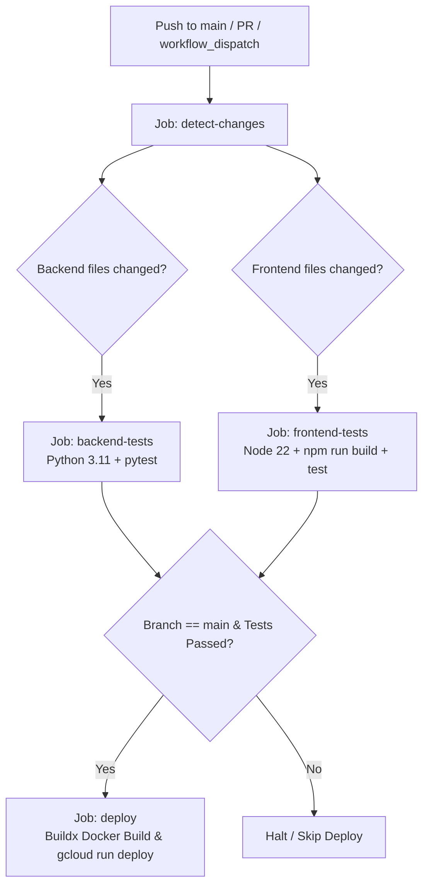

# Git & GitHub Operations Reference: ZAP Platform

This reference documents Git workflows, GitHub CLI integration, CI/CD pipeline mechanics, and automated token injection on ZAP.

---

## 1. Repository Topology & Authentication

- **Repository**: `alendnl/zap`
- **Default Branch**: `main`
- **Git Remote (HTTPS Only)**: `https://github.com/alendnl/zap.git` — never use SSH (`git@github.com*`) or cached macOS Keychain work credentials in this repo.
- **Git & GitHub Token Handling**: Automatically loaded from `GIT_TOKEN` in `.env` by `zap-ops`:
  - `zap-ops github ...` injects `GIT_TOKEN` into `GH_TOKEN`.
  - `zap-ops git <push|pull|fetch|exec>` uses a temporary `GIT_ASKPASS` helper with `-c credential.helper=` so remote Git operations authenticate exclusively over HTTPS as `alendnl` without storing tokens in `.git/config` or hitting OS keychain work accounts.

---

## 2. GitHub CI/CD Workflow (`.github/workflows/ci.yml`)

The repository uses a smart, path-filtered GitHub Actions workflow (`ZAP CI`):



### Path Filtering Logic
- **Docs & Skills ignored**: Pushes modifying only `docs/**`, `.agents/**`, `.issues/**`, or `*.md` skip test and deployment pipelines automatically.
- **Backend changes**: Files in `ZAP-BE/**`, `pytest.ini`, `.github/workflows/**` trigger `backend-tests`.
- **Frontend changes**: Files in `ZAP-FE/**`, `package.json`, `package-lock.json` trigger `frontend-tests`.

---

## 3. GitHub Operations via CLI

### 3.1 List Workflow Runs
```bash
# List recent CI runs on the repo:
.agents/skills/project-operations/scripts/zap-ops github runs --limit 5

# List runs specifically for ci.yml:
.agents/skills/project-operations/scripts/zap-ops github runs --workflow ci.yml --limit 3
```

### 3.2 View Workflow Details & Failure Logs
```bash
# View summary of a run:
.agents/skills/project-operations/scripts/zap-ops github view <RUN_ID>

# Directly print failed job and step logs:
.agents/skills/project-operations/scripts/zap-ops github view <RUN_ID> --failed-logs
```

### 3.3 Trigger Manual CI/CD Deployment
```bash
# Trigger CI for all components on main:
.agents/skills/project-operations/scripts/zap-ops github trigger --workflow ci.yml --ref main --target all

# Trigger backend-only build and deploy:
.agents/skills/project-operations/scripts/zap-ops github trigger --workflow ci.yml --ref main --target backend
```

### 3.4 Arbitrary `gh` Commands
```bash
# Run any gh command using zap-ops wrapper (automatically authenticated with GIT_TOKEN):
.agents/skills/project-operations/scripts/zap-ops github exec pr list
.agents/skills/project-operations/scripts/zap-ops github exec release list
```

---

## 4. Local & Authenticated Remote Git Operations

```bash
# Check working tree and branch:
.agents/skills/project-operations/scripts/zap-ops git status

# View recent commit history with author and date:
.agents/skills/project-operations/scripts/zap-ops git recent -n 5

# Authenticated remote operations over HTTPS (using GIT_TOKEN from .env, bypassing SSH & OS keychain):
.agents/skills/project-operations/scripts/zap-ops git push origin main
.agents/skills/project-operations/scripts/zap-ops git pull origin main
.agents/skills/project-operations/scripts/zap-ops git fetch --all
.agents/skills/project-operations/scripts/zap-ops git exec ls-remote origin

# Local read-only Git commands:
git diff --stat HEAD~1 HEAD
git log --oneline -n 10
```
