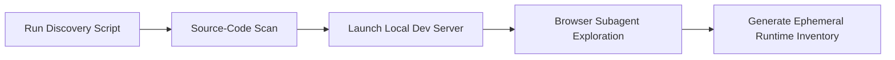
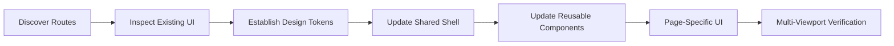

# Universal Website Operator Skill

A production-grade, framework-agnostic capability for discovering, navigating, inspecting, interacting with, modifying, redesigning, debugging, refactoring, and testing any web application.

This skill operates dynamically on any modern web project without hardcoded route lists, adapts to any frontend framework, and enforces honest browser-verified results.

---

## ⚡ Quick Orientation (Read First)

Before diving into a task, orient yourself in 3 fast steps:

1. **Classify the task** → Pick a mode from the [Task Classification Matrix](#-task-classification-matrix) below.
2. **Check if the dev server is running** → Start it if needed (`npm run dev --workspace=ZAP-FE` or project equivalent).
3. **Decide scope** → Single page? Full site? Ask if genuinely ambiguous; otherwise infer from context.

Each mode has an explicit **"Done When…"** definition — use it to know when to stop.

---

## 🧭 Core Operating Principles

1. **Dual-Track Dynamic Discovery**: Combine source-code static inspection (manifest, AST, router files) with live browser exploration (rendered DOM, links, navbars). Never rely on hardcoded route lists.
2. **Framework & Architecture Agnostic**: Automatically detect whether the target is Next.js (App or Pages Router), React Router/Remix, SvelteKit, Nuxt/Vue, Astro, or static HTML.
3. **Respect Existing Code & Reuse**: Inspect before modifying. Reuse existing components, design tokens, and utilities rather than duplicating parallel elements.
4. **Browser-First Live Verification**: A successful build (`npm run build` or `pytest`) does NOT prove the UI works. Visual and functional verification in the browser across viewports is mandatory.
5. **Strict Safety & Gated Permissions**: Read-only during discovery. Never tamper with production databases, never expose credentials, and ask the user when authentication is required.
6. **Strict QA Database Isolation (ZAP)**: The data layer routes via `X-ZAP-ENV: qa` to `zap_platform_lower`. NEVER write to `zap_platform_prod`. See [qa-environment-testing.md](./references/qa-environment-testing.md) for setup and credentials. For non-ZAP projects, apply the same principle: test against a non-production data layer.
7. **Parallelism on Multi-Page Tasks**: For tasks covering 4+ pages, spawn parallel browser subagent sessions (one per page group) and merge findings. This cuts wall-clock time significantly on full-site redesigns and audits.
8. **Error Recovery**: If the dev server crashes during a task, restart it and resume from where the last verified page left off. If a browser subagent times out, spawn a fresh one — it costs nothing to restart. Never report a task complete when recovery is mid-flight.

---

## 🎯 Task Classification Matrix

Pick the mode that matches the user's intent. When a request spans two modes (e.g., "refactor and then test"), run them sequentially — Refactor first, then Test.

| Mode | Typical Triggers | Done When… | Key Reference |
| :--- | :--- | :--- | :--- |
| **1. Explore** | *"What pages exist?", "Map the site", "Show me the structure"* | Ephemeral inventory delivered with Discovery/Visited/Verified status per route. | [discovery-strategy.md](./references/discovery-strategy.md) |
| **2. Redesign** | *"Redesign the website", "Modernize the UI", "Make it look better", "it looks bad / generic"* | Every touched page verified at Desktop + Mobile in the browser with zero console errors and zero TypeScript build errors. | [ui-design-guidelines.md](./references/ui-design-guidelines.md) |
| **3. Enhance** | *"Add feature X", "Add a search bar", "Implement a tab"* | Feature is working in browser, no unintended regressions on adjacent pages, build passes. | [source-code-analysis.md](./references/source-code-analysis.md) |
| **4. Debug** | *"Fix X bug", "Why is the page blank?", "Button not working"* | Root cause identified and confirmed fixed via browser reproduction; console is clean. | [debugging-strategy.md](./references/debugging-strategy.md) |
| **5. Test** | *"Test this flow", "Verify submission", "Run a regression"* | All interaction steps executed in browser, assertions checked, findings reported per route. | [browser-interaction.md](./references/browser-interaction.md) + [test-generation.md](./references/test-generation.md) |
| **6. Audit** | *"Audit responsiveness", "Check mobile", "Find inconsistencies", "WCAG / accessibility"* | All specified pages checked at all three viewport tiers; WCAG and performance notes delivered. | [verification-guidelines.md](./references/verification-guidelines.md) |
| **7. Refactor** | *"Clean up duplication", "Refactor the navbar", "Consolidate components"* | Duplicate code consolidated, visual output unchanged (verified in browser), build passes. | [refactor-workflow.md](./references/refactor-workflow.md) |

---

## 🛠️ Execution Workflows

### 1. Dynamic Website Discovery

Never hardcode website pages. Always discover them dynamically:



```bash
# Step 1: Source-code route scan
python3 .agents/skills/universal-website-operator/scripts/discover_routes.py --format markdown

# Step 2: Start dev server if needed
npm run dev --workspace=ZAP-FE   # or project equivalent

# Step 3: Generate inventory (after browser pass)
python3 .agents/skills/universal-website-operator/scripts/generate_inventory.py
```

> Full details → [discovery-strategy.md](./references/discovery-strategy.md)

---

### 2. Browser Automation Protocol

Always use the **Antigravity Browser Subagent** for live visual and interaction work.

```python
# Launch once; reuse with send_message for subsequent steps
invoke_subagent(
    TypeName="browser",
    Role="Website Interaction & Verification Specialist",
    Prompt="""
Navigate to http://localhost:3000.
1. Inspect the top navigation bar; confirm all links render.
2. Check DevTools console for JS errors or React hydration warnings.
3. Capture a full-page desktop screenshot.
4. Resize viewport to 375x812 (Mobile) and check for horizontal overflow.
5. Report all findings clearly with screenshots.
"""
)
# Subsequent steps: reuse conversationId via send_message, do NOT spawn a new subagent
```

**Key rules:**
- Do NOT pre-probe with `curl`, `netstat`, or `ps` before delegating — go directly to the browser subagent.
- After `invoke_subagent` or `send_message`, stop calling tools and wait for the report.
- Reuse the existing subagent session for multi-step flows; a parked subagent costs zero tokens.

> Full details → [browser-interaction.md](./references/browser-interaction.md)

---

### 3. Multi-Page Parallelism Strategy

For tasks involving 4 or more pages (full redesigns, full audits, full regressions):

```
Route batch A (/)        → Browser Subagent 1
Route batch B (/admin)   → Browser Subagent 2  ← spawn all at once
Route batch C (/login)   → Browser Subagent 3
```

1. Split discovered routes into groups of 2–3 pages each.
2. Spawn one browser subagent per group in the **same turn** (`invoke_subagent` ×N).
3. After all groups report back, merge findings into the ephemeral inventory.
4. Flag pages needing follow-up and re-verify those in a single consolidated browser session.

This pattern reduces a 10-page audit from ~15 min to ~5 min.

---

### 4. QA Database Testing & Persona Login (ZAP)

Activate QA routing before any database interaction or login:

```javascript
// In browser subagent: activate QA data layer
localStorage.setItem("zap.environment", "qa");
window.dispatchEvent(new Event("zap:environment-change"));
```

| Persona | Email | Password | Access |
| :--- | :--- | :--- | :--- |
| Student | `qa.student@codezap.in` | `QAPassword123!` | Public arena, compiler, contests |
| Admin | `qa.admin@codezap.in` | `QAAdminPass123!` | Full admin hub, question & MCQ studios |

```bash
# Reset or verify QA test users (never touches prod)
.venv/bin/python .agents/skills/universal-website-operator/scripts/qa_db_seed_users.py seed
```

> Full protocol → [qa-environment-testing.md](./references/qa-environment-testing.md)

**Non-ZAP projects:** Apply the same principle — identify the project's test/staging data layer and use dedicated test credentials. Never write to production data during automated browser sessions.

---

### 5. Full Website Redesign Protocol



> [!IMPORTANT]
> Never redesign only the homepage when a full-site redesign is requested. Every discovered route must be touched.

> Full details → [ui-design-guidelines.md](./references/ui-design-guidelines.md)

---

### 6. Frontend Debugging Protocol

5-phase triage loop — do not skip phases or assume root cause before seeing live evidence:

1. **Reproduce** → Browser subagent executes user steps exactly
2. **Capture Evidence** → DevTools console + network errors + screenshot of broken state
3. **Trace Source** → Map stack trace to component file + line; check recent `git diff`
4. **Surgical Fix** → Minimal patch only; do not refactor adjacent working code
5. **Verify** → Re-run reproduction; confirm clean console; run build check

> Full details + common failure patterns → [debugging-strategy.md](./references/debugging-strategy.md)

---

### 7. Multi-Viewport Verification Gate

Before declaring **any** frontend task complete:

- [ ] **Desktop (1440 × 900)**: Wide grids, persistent sidebars, Monaco editor split views
- [ ] **Tablet (768 × 1024)**: Responsive collapse, card wrap, touch targets ≥ 44px
- [ ] **Mobile (375 × 812)**: Single-column stack, zero horizontal scrollbar, hamburger menu
- [ ] **Console**: Zero uncaught exceptions, zero hydration errors, zero broken 404 assets
- [ ] **Build**: `npm run build --workspace=ZAP-FE` exits with zero TypeScript errors

> Full checklist → [verification-guidelines.md](./references/verification-guidelines.md)

---

### 8. Error Recovery Protocol

| Failure | Recovery Action |
| :--- | :--- |
| Dev server crashes mid-task | Restart server; resume from last **Verified** page in inventory; do not re-verify already-green pages |
| Browser subagent timeout | Spawn a fresh browser subagent; re-navigate to the last unverified URL |
| Build fails mid-redesign | Fix only the TypeScript errors reported; never revert unrelated working changes |
| Auth wall encountered | Pause and ask the user to authenticate; resume the same subagent session via `send_message` |
| 404 on discovered route | Flag as "Broken" in inventory; report to user; do not block progress on other routes |

---

## 🛡️ Safety & Operational Rules

1. **Strict QA Data Isolation**: All automated mutations target non-production data only.
2. **Read-Only During Discovery**: Never alter code or database records in Explore/Audit modes.
3. **Preserve User Changes**: Never overwrite unrelated user edits.
4. **No Destructive Operations**: Never delete tables or trigger destructive API calls without explicit approval.
5. **No Security Bypasses**: Never spoof tokens, disable auth checks, or solve CAPTCHAs.
6. **Honest Verification**: "Verified" means actually visited in browser — not assumed, not build-only.

---

## 🗂️ Supporting References & Scripts

| Resource | Purpose |
| :--- | :--- |
| [references/discovery-strategy.md](./references/discovery-strategy.md) | Dual-track route discovery, framework detection, inventory schema |
| [references/qa-environment-testing.md](./references/qa-environment-testing.md) | QA database routing, ZAP credentials, activation protocol |
| [references/browser-interaction.md](./references/browser-interaction.md) | Browser subagent invocation, session continuity, auth handling, Playwright fallback |
| [references/source-code-analysis.md](./references/source-code-analysis.md) | Manifest audit, component hierarchy, styling tokens, API layer inspection |
| [references/ui-design-guidelines.md](./references/ui-design-guidelines.md) | Design system, anti-slop patterns, 10-step redesign workflow |
| [references/debugging-strategy.md](./references/debugging-strategy.md) | 5-phase triage loop, common failure modes (hydration, z-index, closures) |
| [references/verification-guidelines.md](./references/verification-guidelines.md) | Multi-viewport checklist, WCAG, sign-off protocol |
| [references/test-generation.md](./references/test-generation.md) | Test scenario authoring, assertion patterns, multi-step flow testing |
| [references/refactor-workflow.md](./references/refactor-workflow.md) | Safe consolidation loop, duplication detection, visual regression guard |
| [scripts/discover_routes.py](./scripts/discover_routes.py) | AST-based route scanner |
| [scripts/generate_inventory.py](./scripts/generate_inventory.py) | Runtime inventory generator |
| [scripts/qa_db_seed_users.py](./scripts/qa_db_seed_users.py) | QA user management (seed / verify / credentials) |
