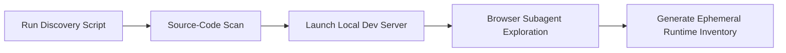

# Universal Website Interaction Skill

A production-grade, framework-agnostic capability for discovering, navigating, inspecting, interacting with, modifying, redesigning, debugging, and testing an entire web application.

This is a general-purpose website interaction and frontend engineering capability, designed to operate dynamically on any modern web project without maintaining hardcoded route lists.

---

## 🧭 Core Operating Principles

1. **Dual-Track Dynamic Discovery**: Combine source-code static inspection (manifest, AST, router files) with live browser exploration (rendered DOM, links, navbars). Never rely on hardcoded route lists.
2. **Framework & Architecture Agnostic**: Automatically detect whether the target is Next.js (App or Pages Router), React Router/Remix, SvelteKit, Nuxt/Vue, Astro, or static HTML.
3. **Respect Existing Code & Reuse**: Inspect before modifying. Reuse existing components, design tokens, and utilities rather than duplicating parallel elements.
4. **Browser-First Live Verification**: A successful build (`npm run build` or `pytest`) does NOT prove the UI works. Visual and functional verification in the browser across viewports is mandatory.
5. **Strict Safety & Gated Permissions**: Read-only during discovery. Never tamper with production databases, never expose credentials, and ask the user when authentication is required.
6. **Strict QA Database Isolation (Single Backend, Dual Data)**: While the backend server is always production (`zap-api`), the data layer routes dynamically via `X-ZAP-ENV: qa` to the QA database (`zap_platform_lower`). NEVER write to or modify `zap_platform_prod`. All test accounts, test submissions, and automated browser sessions must operate exclusively against `zap_platform_lower`.

---

## 🎯 Task Classification Matrix

Classify the user's prompt into one of the seven operational modes and execute the tailored workflow:

| Workflow Mode | Typical Triggers | Primary Objectives | Key References |
| :--- | :--- | :--- | :--- |
| **1. Explore** | *"Explore the site", "What pages exist?", "Map out website structure"* | Discover all routes, map component hierarchies, generate ephemeral inventory. | [discovery-strategy.md](./references/discovery-strategy.md) |
| **2. Redesign** | *"Redesign the website", "Modernize the look", "Upgrade UI/UX"* | Full-site or single-page redesign, establish design tokens, modernize layouts and shared components, verify across viewports. | [ui-design-guidelines.md](./references/ui-design-guidelines.md) |
| **3. Enhance** | *"Add feature X", "Add search bar to contest page", "Implement tab"* | Locate target component, preserve existing contracts, implement feature, verify interaction. | [source-code-analysis.md](./references/source-code-analysis.md) |
| **4. Debug** | *"Fix button not working", "Resolve hydration error", "Why is page blank?"* | Reproduce in browser subagent, capture console/network errors, trace source, fix surgically. | [debugging-strategy.md](./references/debugging-strategy.md) |
| **5. Test** | *"Test checkout flow", "Verify student submission", "Run regression"* | Generate interaction scenarios, fill forms, trigger clicks, validate DOM and network state. | [browser-interaction.md](./references/browser-interaction.md) |
| **6. Audit** | *"Audit responsiveness", "Check mobile view", "Find UI inconsistencies"* | Check desktop/tablet/mobile breakpoints, detect horizontal scrollbars, verify WCAG contrast. | [verification-guidelines.md](./references/verification-guidelines.md) |
| **7. Refactor** | *"Clean up component duplication", "Refactor navbar", "Split monolith"* | Consolidate duplicate UI, decouple modules, preserve exact existing visual behavior. | [source-code-analysis.md](./references/source-code-analysis.md) |

---

## ⚡ Execution Workflows

### 1. Dynamic Website Discovery Workflow

Never hardcode website pages. Always discover them dynamically:



1. **Run Route Scanner**:
   ```bash
   python3 .agents/skills/universal-website-operator/scripts/discover_routes.py --format markdown
   ```
2. **Browser Exploration**:
   - Start local dev server if not already running (e.g. `npm run dev --workspace=ZAP-FE`).
   - Delegate to Antigravity Browser Subagent (`invoke_subagent` with `TypeName: "browser"`).
   - Inspect rendered DOM, header navigation, sidebars, footer links, and user menus.
3. **Generate Ephemeral Inventory**:
   ```bash
   python3 .agents/skills/universal-website-operator/scripts/generate_inventory.py
   ```
   > Full details: [discovery-strategy.md](./references/discovery-strategy.md)

---

### 2. Browser Automation Protocol

Prefer the native **Antigravity Browser Subagent** via `invoke_subagent`.

```python
# 1. Launch Browser Subagent
invoke_subagent(
    TypeName="browser",
    Role="Website Interaction & Verification Specialist",
    Prompt="""
Navigate to http://localhost:3000.
1. Inspect the top navigation bar and verify that all links render.
2. Check Chrome DevTools console for JavaScript errors or React hydration warnings.
3. Capture a full-page desktop screenshot.
4. Resize viewport to 375x812 (Mobile) and check for horizontal overflow.
5. Report findings clearly.
"""
)

# 2. Maintain Session Continuity for Subsequent Steps
# Reuse conversationId returned by invoke_subagent:
send_message(
    Recipient=conversationId,
    Message="Click on 'Contests' and verify the contest arena renders."
)
```

- **Authentication & Login**: When gated pages or login modals are encountered, either input local demo credentials or pause and prompt the user to authenticate in the open browser tab.
- **Headless Fallback**: In environments lacking an interactive Chrome subagent, use Playwright CLI runners (`npx playwright test`).
> Full details: [browser-interaction.md](./references/browser-interaction.md)

---

### 3. QA Database Testing & Persona Login Protocol

The platform runs a single production backend on Cloud Run (`zap-api`), with dynamic runtime database routing controlled by request headers. All automated exploration, test users, and data modifications **must strictly target the lower QA database (`zap_platform_lower`)**:

1. **Activate QA Environment**:
   - In browser subagent, ensure `localStorage.setItem("zap.environment", "qa")` is executed or the `EnvironmentSwitcher` in the top bar is toggled to **QA**.
   - All outgoing requests inject `X-ZAP-ENV: qa`, routing queries to `zap_platform_lower`.
2. **Student Flow Testing**:
   - **Credentials**: `qa.student@codezap.in` / `QAPassword123!`
   - Log in at `/login` to test public problem arena, code compiler, and contest participation.
   - Access to `/admin` is properly denied (`isAdmin: false`).
3. **Admin & Faculty Flow Testing**:
   - **Credentials**: `qa.admin@codezap.in` / `QAAdminPass123!`
   - Log in at `/login` to test Admin Hub (`/admin`), User Stats (`/admin/users`), Question Studio (`/admin/questions`), MCQ Studio (`/admin/mcq`), and Faculty creation (`/faculty/questions/new`).
4. **Manage QA Users Script**:
   ```bash
   # Reset or verify QA test users in zap_platform_lower (never touches prod)
   .venv/bin/python .agents/skills/universal-website-operator/scripts/qa_db_seed_users.py seed
   ```
> Full details: [qa-environment-testing.md](./references/qa-environment-testing.md)

---

### 4. Full Website Redesign Protocol

When requested to redesign the website:

1. **Discover All Routes**: Run discovery to get the full scope of pages.
2. **Inspect Existing UI**: Review layouts, color palettes, and component structures.
3. **Establish Design System**: Define palette, typography, and spacing tokens in `tailwind.config.js` and `globals.css`.
4. **Update Shared Shell First**: Modernize `RootLayout`, `Navbar`, `Sidebar`, and `Footer`.
5. **Modernize Core Reusable Components**: Update buttons, inputs, cards, and modal dialogs.
6. **Iterate Page-Specific UI**: Apply new styling to all discovered routes while preserving 100% of functional data flow.
7. **Responsive & Multi-Page Verification**: Visit every redesigned page across Desktop (1440px), Tablet (768px), and Mobile (375px) in the browser subagent.
> [!IMPORTANT]
> Never redesign only the homepage when a full website redesign is requested.
> Full details: [ui-design-guidelines.md](./references/ui-design-guidelines.md)

---

### 5. Frontend Debugging Protocol

When addressing bugs, visual glitches, or broken interactions:

1. **Live Reproduction**: Instruct browser subagent to execute the user steps and observe the failure.
2. **Capture Evidence**: Inspect DevTools console errors, network request status (4xx/5xx), and visual state.
3. **Trace Root Cause**: Map error stack traces or CSS class collisions to the exact component line.
4. **Surgical Fix**: Apply the minimal necessary patch in the source code.
5. **Verify Resolution**: Re-run the scenario in the browser subagent and verify clean console logs.
> Full details: [debugging-strategy.md](./references/debugging-strategy.md)

---

### 6. Multi-Viewport Verification Gate

Before declaring any frontend task complete:

- [ ] **Desktop (1440 x 900)**: Layout balance, wide grids, complex sidebars, split code editors.
- [ ] **Tablet (768 x 1024)**: Responsive card wrap, collapsible drawers, touch targets >= 44px.
- [ ] **Mobile (375 x 812)**: Single-column stack, zero horizontal scrollbar (`scrollWidth <= innerWidth`), accessible hamburger menu.
- [ ] **DevTools Console**: Zero uncaught exceptions, zero hydration errors.
- [ ] **Type Integrity**: Run `npm run build` or workspace check to confirm zero TypeScript compile errors.
> Full details: [verification-guidelines.md](./references/verification-guidelines.md)

---

## 🛡️ Safety & Operational Rules

1. **Strict QA Database Isolation**: All user testing, exploratory mutations, and credential creation MUST occur exclusively in `zap_platform_lower`. Writing to `zap_platform_prod` is prohibited.
2. **Read-Only During Discovery**: Never alter application code or database records during discovery or audit tasks.
3. **Preserve User Changes**: Never overwrite or revert unrelated changes made by the user.
4. **No Destructive Operations**: Never delete database tables, submit real transactions, or trigger destructive API actions without explicit user approval.
5. **No Security Bypasses**: Never attempt to bypass authentication guards, spoof security tokens, or disable access control checks.
6. **Honest Verification**: Never mark a page as "Verified" unless it has actually been visited and inspected in the browser.

---

## 🗂️ Supporting References & Scripts

- **Discovery Deep-Dive**: [references/discovery-strategy.md](./references/discovery-strategy.md)
- **QA Database & Personas**: [references/qa-environment-testing.md](./references/qa-environment-testing.md)
- **Browser Automation Manual**: [references/browser-interaction.md](./references/browser-interaction.md)
- **Source Code Architecture**: [references/source-code-analysis.md](./references/source-code-analysis.md)
- **Design System & Redesign**: [references/ui-design-guidelines.md](./references/ui-design-guidelines.md)
- **Debugging & Diagnostics**: [references/debugging-strategy.md](./references/debugging-strategy.md)
- **Verification Standards**: [references/verification-guidelines.md](./references/verification-guidelines.md)
- **QA Test User Manager**: [scripts/qa_db_seed_users.py](./scripts/qa_db_seed_users.py)
- **Route Scanner Script**: [scripts/discover_routes.py](./scripts/discover_routes.py)
- **Runtime Inventory Generator**: [scripts/generate_inventory.py](./scripts/generate_inventory.py)
