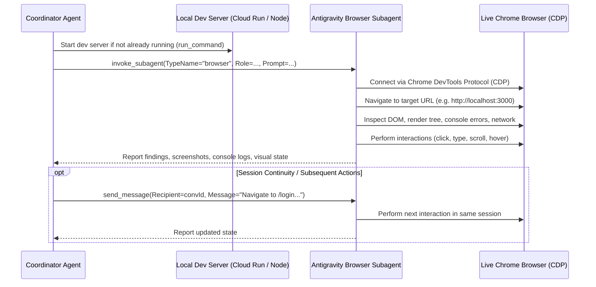

# Antigravity Browser Automation & Interaction Manual

This document details the operational protocol for driving browser automation using Google Antigravity's native capabilities, managing sessions, inspecting live pages, and executing fallbacks.

---

## 1. Antigravity Browser Subagent Architecture

The primary and preferred browser automation engine in Google Antigravity is the **Browser Subagent**.



### Supported Native Capabilities

Through the Chrome DevTools Protocol, the browser subagent supports:
- **Navigation**: Opening URLs, following anchor links, query parameter adjustments, history navigation (back, forward, reload).
- **Element Interaction**: Clicking buttons, typing into inputs, clearing inputs, selecting dropdown items, checkboxes, radio buttons, hovering for tooltips/dropdowns.
- **Scroll & Viewport Control**: Vertical and horizontal scrolling, scrolling elements into view, resizing viewport to test responsiveness (Desktop 1440x900, Tablet 768x1024, Mobile 375x812).
- **Visual Inspection**: Capturing screenshots of full pages or component bounding boxes, inspecting computed CSS styles, layout shifts, z-index stacking.
- **Console Monitoring**: Inspecting `console.error`, `console.warn`, unhandled Promise rejections, React hydration warnings.
- **Network Monitoring**: Tracking HTTP status codes (200, 401, 403, 404, 500), failed XHR/fetch requests, CORS issues.
- **Session & Cookie Persistence**: Preserving session cookies, `localStorage`, `sessionStorage`, and authenticated user tokens across subsequent interactions in the same tab.

---

## 2. Invoking the Browser Subagent

When a task requires visual inspection, DOM interaction, or frontend navigation, delegate to the browser subagent immediately.

### Invocation Pattern

```python
invoke_subagent(
    TypeName="browser",
    Role="Website Visual & Interaction Auditor",
    Prompt="""
Navigate to http://localhost:3000.
1. Inspect the initial rendered view of the application.
2. Verify that the top navigation bar, question list, and environment switcher render properly.
3. Check the Chrome DevTools console for any uncaught exceptions or React hydration errors.
4. Capture a full-page screenshot of the homepage.
5. Resize the viewport to mobile dimensions (375x812) and verify whether the layout adapts cleanly without horizontal overflow.
6. Provide a concise summary of all observed elements, console messages, and layout behavior.
"""
)
```

### Delegation Rules & Invariants

> [!IMPORTANT]
> **No Pre-Probing with CLI**: Do NOT run CLI commands (`curl`, `wget`, `netstat`, `lsof`, `ps`, `python`) to probe, ping, or scrape the URL before delegating to the browser subagent. Start the local server if needed, then immediately delegate to the browser subagent.
>
> **Stop and Wait**: After calling `invoke_subagent` or `send_message`, stop calling tools and wait for the browser subagent to report back. Do not poll in a loop.
>
> **No Imaginary Tools**: Use only actual supported subagent capabilities. Do not invent non-existent browser tools, custom bash flags, or synthetic APIs.

---

## 3. Session Continuity & Multi-Step Interactions

Do not destroy and recreate browser subagents between sequential steps in the same user workflow.

### Maintaining the Session

1. When `invoke_subagent` returns a `conversationId`, record this ID.
2. For subsequent actions (e.g. clicking a link, filling a form, switching pages):
   ```python
   send_message(
       Recipient=conversationId,
       Message="""
Now click on the 'Admin' link in the top navigation bar.
1. Observe whether the page navigates to /admin or triggers an authentication redirect.
2. Check for any console errors.
3. Report the rendered page title and URL.
"""
   )
   ```
3. An idle browser subagent maintains the active browser session, cookies, and tab state with **zero token cost** while waiting.
4. Only call `manage_subagents(Action="kill", ...)` when the entire multi-step task is complete.

---

## 4. Authentication, Session Handling & Gated Pages

Modern web applications often have pages gated by authentication (e.g., student login, faculty/admin credentials).

### Handling Auth Walls & QA Test Personas

1. **Strict QA Routing**:
   - Before interacting with login forms or submitting answers, verify that the browser session is set to QA:
     ```javascript
     localStorage.setItem("zap.environment", "qa");
     ```
   - All outgoing requests will carry `X-ZAP-ENV: qa` to operate solely against `zap_platform_lower`.
2. **Student Authentication Flow**:
   - When validating student views, public problem workspaces, or contest participation:
     - **Email**: `qa.student@codezap.in`
     - **Password**: `QAPassword123!`
   - Verify that student credentials log in, store student profile in `localStorage`, and navigate cleanly to problem arena.
3. **Admin & Faculty Authentication Flow**:
   - When validating privileged management pages (`/admin`, `/admin/users`, `/admin/questions`, `/admin/mcq`, `/admin/contests`):
     - **Email**: `qa.admin@codezap.in`
     - **Password**: `QAAdminPass123!`
   - Verify that `/api/v1/admin/check-access` validates `isAdmin: true` and loads the Admin Hub without 403 barriers.
4. **Interactive User Authentication**:
   - If third-party SSO, MFA, or CAPTCHA are encountered, pause and ask the user directly, resuming the subagent session with `send_message`.

> [!CAUTION]
> Never attempt to bypass access controls or operate on `zap_platform_prod`. Always utilize the QA personas in `zap_platform_lower`.

---

## 5. Viewport Sizing & Responsive Verification

To perform thorough visual verification, instruct the browser subagent to inspect the application at three standard responsive breakpoints:

| Viewport Category | Resolution (Width x Height) | Key Verification Checks |
| :--- | :--- | :--- |
| **Desktop** | 1440 x 900 px | Multi-column grids, split-screen code editors (Monaco), persistent sidebar, top navigation. |
| **Tablet** | 768 x 1024 px | Collapsible sidebars, card reflow, touch-target spacing (> 44px), readable typography. |
| **Mobile** | 375 x 812 px | Single column, hamburger menu drawer, zero horizontal overflow (`scrollWidth <= innerWidth`), form input zoom avoidance. |

### Prompt Instructions for Responsive Checking

Instruct the subagent:
```text
Inspect the page at:
1. Desktop (1440x900)
2. Mobile (375x812)

Check specifically:
- Is there any horizontal scrollbar or element bleeding outside the viewport?
- Does the navigation collapse into a working mobile menu?
- Are buttons and interactive elements fully clickable and unobstructed?
- Are modal dialogs properly centered and dismissible?
```

---

## 6. Playwright Fallback (Headless / Non-Interactive Environments)

In environments where the interactive Antigravity Browser Subagent is not available (such as headless CI/CD pipelines, headless container test runners, or batch CLI validation), use Playwright as a fallback.

### When to Use Fallback
- Automated regression test execution in CI/CD (`npm test`, `npx playwright test`).
- Environments lacking Chrome DevTools UI integration.

### Playwright Verification Command Pattern

```bash
# Run headless browser smoke test if playwright test suite is configured
npx playwright test --reporter=list

# Run single route check if playwright is installed in project
npx playwright test tests/navigation.spec.ts --headed=false
```

If Playwright is not installed in the workspace, do not install heavy global dependencies unless explicitly requested by the user. Rely on the native Antigravity Browser Subagent for interactive inspection and Python route discovery helpers.
