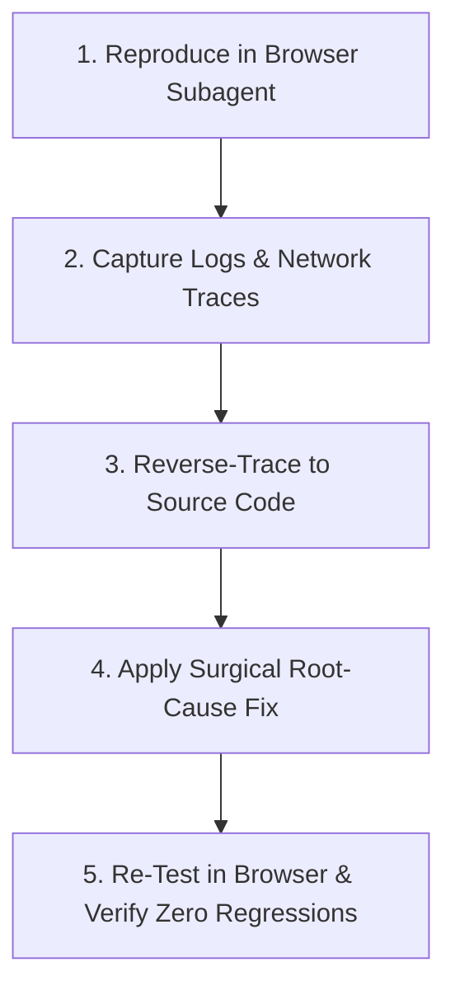

# Frontend Debugging & Diagnostic Strategy

Debugging web applications requires a disciplined, evidence-based triage loop combining live browser inspection with source-code tracing.

---

## 1. 5-Phase Frontend Triage Loop



### Phase 1: Live Reproduction
- Instruct the Antigravity Browser Subagent to navigate to the exact route and perform the sequence of user interactions that triggers the bug.
- Avoid guessing or assuming the cause before seeing the live failure.

### Phase 2: Evidence Capture
- **DevTools Console**: Check `console.error` and `console.warn` outputs for runtime exceptions, React warnings, or hydration errors.
- **Network Tab**: Inspect failed HTTP requests (400, 401, 403, 404, 500) and check request/response payloads.
- **Visual State**: Capture a screenshot of the broken UI to inspect alignment, clipping, or missing elements.

### Phase 3: Source Code Isolation
- Map the error stack trace or DOM selector back to the specific React component and line numbers.
- Check git history (`git diff` or `git log -S`) to see recent modifications affecting the component.

### Phase 4: Surgical Root-Cause Fix
- Modify only the code necessary to solve the underlying defect.
- Do not refactor adjacent systems or rewrite functioning features.

### Phase 5: Verification & Zero Regression
- Re-run the reproduction sequence in the browser subagent.
- Confirm the error no longer appears in the DevTools console.
- Run automated build checks (`npm run build` or `pytest`) to verify type integrity.

---

## 2. Common Frontend Failure Modes & Solutions

### A. Next.js Hydration Mismatch (`Text content did not match server-rendered HTML`)

- **Root Cause**: Component renders different HTML on the server vs. client (e.g. reading `window`, `localStorage`, `new Date()`, or browser theme during initial render).
- **Solution**:
  ```tsx
  // Guard client-only features with a mounted state
  const [mounted, setMounted] = useState(false);
  useEffect(() => {
    setMounted(true);
  }, []);

  if (!mounted) {
    return <div className="min-h-screen bg-slate-900" />; // Neutral skeleton/fallback
  }
  ```

### B. Mobile Horizontal Overflow (`scrollWidth > innerWidth`)

- **Root Cause**:
  - Using `w-screen` inside a scrollable container.
  - Preformatted code (`<pre>` or `<code>`) without `overflow-x-auto` or `break-words`.
  - Flex child with `min-w-max` or fixed pixel width wider than 375px.
- **Solution**:
  - Replace `w-screen` with `w-full`.
  - Add `min-w-0` to flex child containers so text truncation (`truncate`) works.
  - Wrap code blocks in `overflow-x-auto max-w-full`.

### C. Z-Index & Stacking Context Collisions

- **Root Cause**: Modals, tooltips, or sticky headers getting hidden behind other elements due to parent `transform`, `opacity`, or lower `z-index`.
- **Solution**:
  - Mount modals at document root via React Portal (`createPortal`) or top-level layout wrapper.
  - Use systematic z-index tokens: `z-10` (sticky), `z-20` (dropdown), `z-30` (header), `z-40` (drawer), `z-50` (modal).

### D. Stale Closures & Infinite Re-render Loops

- **Root Cause**:
  - Missing dependencies in `useCallback` or `useEffect`.
  - Setting state inside `useEffect` without proper dependency guarding.
- **Solution**:
  - Use functional state updates `setState(prev => ...)` to avoid dependency on current state value.
  - Ensure all referenced props and state variables are explicitly listed in dependency arrays.

### E. Silent API / Network Failures

- **Root Cause**: Frontend fetch catches an error but displays an empty state without notifying the user or showing an error retry button.
- **Solution**:
  - Always handle three states in data-fetching UI: Loading skeleton, Error alert with Retry button, and Populated data.
  - Verify environment base URL configuration (`src/services/environment.ts`).

---

## 3. Error Recovery During Debug Sessions

When the debugging environment itself breaks:

| Failure | Recovery |
| :--- | :--- |
| **Dev server crashes** | Restart: `npm run dev --workspace=ZAP-FE`. Resume from the last reproduction step — do not restart the whole triage loop. |
| **Browser subagent times out** | Spawn a fresh browser subagent. Navigate to the same URL and re-run reproduction. Prior findings are still valid. |
| **Build fails after attempted fix** | Read the TypeScript errors carefully. Fix only what the compiler reports — do not change the original bug fix unless it caused the error. |
| **Hot-reload loop (HMR instability)** | Hard-reload the browser (`Ctrl+Shift+R` or `Cmd+Shift+R`). If persisting, restart the dev server. |
| **Multiple unrelated console errors** | Distinguish baseline noise (pre-existing errors) from regressions introduced by your fix. Document baseline errors before making any changes. |

---

## 4. Reading Stack Traces Effectively

When a React or Next.js error appears in DevTools console:

```
Uncaught TypeError: Cannot read properties of undefined (reading 'map')
  at QuestionList (QuestionList.tsx:42:18)
  at renderWithHooks (react-dom.development.js:...)
```

**Reading process:**
1. Find the **first line pointing to your source code** (not `react-dom`, `webpack`, or `node_modules`).
2. The file + line number (`QuestionList.tsx:42`) is your starting point.
3. Open that file and read line 42. The error says `undefined.map()` — look for a `.map()` call and check whether the data it's called on can be `undefined`.
4. Trace upward: where does that data come from? Is it from a prop, context, or fetch? Is there a loading state that might make it `undefined` before data arrives?

**Common React error signatures:**

| Error | Likely Cause |
| :--- | :--- |
| `Cannot read properties of undefined (reading 'map')` | Array is `undefined` during initial render; missing loading guard |
| `Text content did not match` | Hydration mismatch — server and client rendered different HTML |
| `Objects are not valid as a React child` | Passing an object (not string/number/element) directly into JSX |
| `Each child in a list should have a unique "key" prop` | Missing `key` prop in `.map()` — not a crash, but causes stale render bugs |
| `Warning: Can't perform a React state update on an unmounted component` | `useEffect` cleanup missing; async operation resolves after component unmount |
