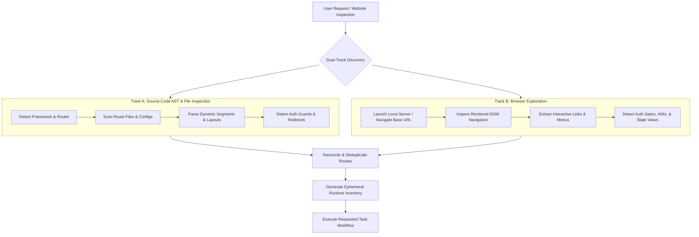

# Dynamic Website Discovery Strategy

The **Universal Website Interaction Skill** relies on a dual-track dynamic discovery engine. It guarantees full awareness of an entire web application without ever hardcoding route lists into the codebase.

---

## 1. Dual-Track Discovery Architecture



---

## 2. Track A: Source-Code Discovery Engine

Do not assume a specific frontend framework. Automatically inspect the project's dependency manifest and folder hierarchy to detect the routing model.

### Framework Detection Matrix

| Framework / Architecture | Indicators | Route Resolution Rule | Layout / Shell Location |
| :--- | :--- | :--- | :--- |
| **Next.js (App Router)** | `next` in dependencies, `app/` or `src/app/` folder | Files named `page.{tsx,jsx,js,ts}`. Skip `(groups)`, convert `[param]` to `:param`, `[...slug]` to `/*slug`. | `layout.{tsx,jsx,js,ts}` in current or ancestor folders |
| **Next.js (Pages Router)** | `next` in dependencies, `pages/` or `src/pages/` | All files under `pages/` except `_app`, `_document`, `_error`, `api/`. | `pages/_app.{tsx,jsx}` or custom layout wrappers |
| **SvelteKit** | `@sveltejs/kit` in dependencies, `src/routes/` | Files named `+page.svelte`. Skip `(groups)`, `[param]` segments. | `+layout.svelte` hierarchy |
| **Nuxt / Vue** | `nuxt` or `vue-router` in dependencies, `pages/` | Files in `pages/**/*.vue` mapped to URL paths. | `layouts/default.vue` |
| **React Router / Remix** | `react-router`, `react-router-dom`, `@remix-run/react` | Parse `routes.ts`, `<Route path="..." element={...}>`, or `createBrowserRouter` config. | Top-level `<Outlet />` wrappers |
| **Astro** | `astro` in dependencies, `src/pages/` | Files in `src/pages/**/*.{astro,md,mdx}`. | `src/layouts/*.astro` |
| **Static HTML / Vanilla** | `*.html` files in root or `public/` | Direct file mapping relative to web root. | Template partials or standalone headers |

### Inspecting Route Parameters & Dynamic Segments

1. **Single Dynamic Parameter**: `[id]`, `:id`, or `[slug]` indicates a detail view requiring a sample or mock parameter (e.g. `/questions/1` or `/users/demo`).
2. **Catch-All Segments**: `[...slug]` or `*` indicates variable path depth. Inspect the component source to determine valid sample sub-paths.
3. **Route Groups & Slots**: Folder names with parentheses `(admin)`, `(student)` or parallel slots `@modal` do not affect the public URL path. Strip them when resolving the route URL.

### Detecting Authentication Guards & Role Gates

Inspect page files, layouts, and middleware for protection mechanisms:
- **Next.js Middleware**: Check `middleware.ts` or `src/middleware.ts` for matcher patterns and redirect conditions.
- **Client Route Guards**: Check for imports like `useAuth`, `getStoredStudent`, `<ProtectedRoute>`, `<AuthGuard>`, `withAuth`.
- **Imperative Redirects**: Look for `router.replace('/login')`, `redirect('/login')`, or `window.location.href = ...`.
- **Role Permissions**: Look for checks on `user.role`, `isFaculty`, `isAdmin`, or permission scopes.

---

## 3. Track B: Browser-Driven Discovery

Source code analysis can reveal hidden or unlinked routes, but browser interaction reveals how users actually experience and traverse the application.

### Discovery Walkthrough via Browser Subagent

1. **Start at Application Entry Point**:
   - Navigate to base URL (e.g., `http://localhost:3000`).
   - Allow client-side hydration and dynamic data fetches to complete.
2. **Inspect Visible Navigation Components**:
   - Extract links from header navbar (`<nav>`, `header a`).
   - Extract links from sidebars, drawer menus, and category lists.
   - Extract footer links (`footer a`) and utility bars.
   - Inspect user profile / account dropdowns for hidden routes (Settings, Profile, Logout, Admin Hub).
3. **Identify Interactive Transition Elements**:
   - Tabs (`[role="tab"]`), segmented buttons, filter pills.
   - Accordions and expandable drawers containing sub-page links.
   - Action buttons triggering navigation (e.g. "Create New Problem", "Start Contest").
4. **Detect Access Controls and Gated States**:
   - When navigating to protected routes (e.g. `/faculty/questions/new`), check if the application redirects to `/login` or opens an authentication modal.
   - Note which pages are public vs. student-authenticated vs. faculty/admin-authenticated.
5. **Detect Broken or Error States**:
   - Observe HTTP 404 (Not Found) pages.
   - Observe HTTP 500 error boundaries, React crash screens, or unhandled promise rejections in Chrome DevTools.
   - Flag broken internal links or stale route configurations.

---

## 4. Track C: Ephemeral Runtime Inventory Protocol

When a user task requires broad or website-wide awareness (such as full redesign, visual audit, or regression testing), generate a temporary runtime inventory artifact.

### Schema Definition

```markdown
| Route URL | Page Purpose | Layout / Components | Auth Requirement | Discovery Status | Browser Verification Status | Notes / Interactions |
| :--- | :--- | :--- | :--- | :--- | :--- | :--- |
| `/` | Student Workspace & Problem Arena | `RootLayout`, `StudentWorkspace`, `MonacoEditor` | Public / Student Auth | Discovered (Source) | Verified | Desktop & Mobile clean |
| `/admin` | Admin Management Hub | `RootLayout`, `AdminHeader`, `AdminGrid` | Role-Gated (Admin) | Discovered (Source) | Visited | Auth wall encountered |
| `/login` | Authentication Portal | `RootLayout`, `StudentAuthView` | Public | Discovered (Source) | Verified | Form validation works |
```

### Verification Status Lifecycle

1. **Discovered**: Found via source code scan or anchor link tag; not yet opened in the browser.
2. **Visited**: Successfully navigated to in the browser subagent; DOM mounted without crash.
3. **Verified**: Visually inspected across desktop (1440px), tablet (768px), and mobile (375px) viewports with zero console errors and zero unexpected layout overflow.
4. **Inaccessible / Gated**: Requires credentials, elevated role, or specific session state that could not be satisfied automatically.
5. **Error / Broken**: Encountered 404, unhandled client exception, or fatal rendering error.

### Core Inventory Invariants

> [!IMPORTANT]
> **Ephemeral Only**: The runtime inventory must NEVER be committed as a permanent hardcoded list in repository source code. It is generated dynamically via `scripts/discover_routes.py` and maintained in session memory or temporary artifacts.
>
> **Honesty Invariant**: Never claim complete website coverage if only a subset of routes has been verified. Clearly differentiate between `Discovered`, `Visited`, and `Verified`.
