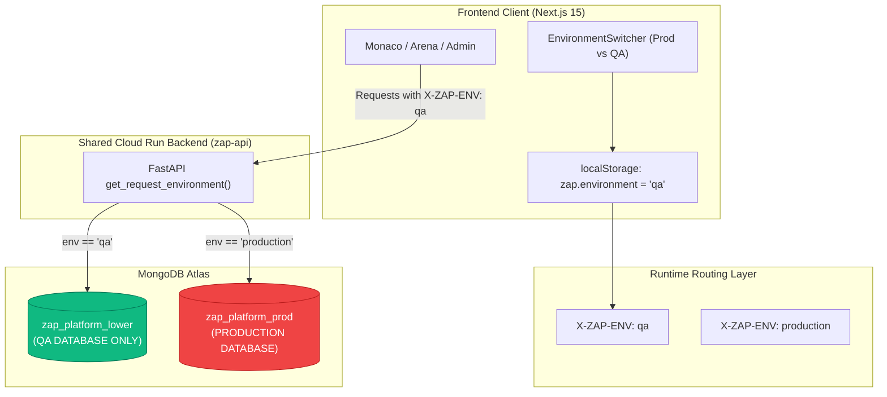

# QA Database Routing & Test Credentials Manual

This document defines the strict QA database operating model, credential personas, and safety protocols for interacting with the ZAP web application.

---

## 1. Architectural Topology: Single Backend, Dual Data

The ZAP platform runs a single production backend service on GCP Cloud Run (`zap-api`). Dynamic multi-tenancy is controlled at runtime via request headers and database routing:



### Safety Invariant: QA Database Only

> [!CAUTION]
> **Production Data Protection Rule**:
> - The production database (`zap_platform_prod`) contains real student submissions, active leaderboards, and live user data.
> - **NEVER** create test users, modify documents, or submit test solutions against `zap_platform_prod`.
> - All website interaction, automated browser exploration, user session simulation, and database writes **MUST EXCLUSIVELY TARGET** the lower QA database: `zap_platform_lower`.
> - Server compute is shared (production Cloud Run), but the data store is isolated via `X-ZAP-ENV: qa`.

---

## 2. Test Personas & QA Credentials

Two dedicated, pre-seeded test accounts exist in `zap_platform_lower` to validate both standard student and privileged administrator flows:

### Persona A: Regular Student Test User
- **Purpose**: Test standard coding flows, Monaco editor code execution, question navigation, and contest submissions.
- **Email**: `qa.student@codezap.in`
- **Student ID**: `QA-STU-001`
- **Password**: `QAPassword123!`
- **Name**: `QA Test Student`
- **College**: `ZAP QA Testing College`
- **Access Level**:
  - ✅ Public Arena (`/`, `/?problem=...`)
  - ✅ Vanilla Compiler (`/?mode=compiler`)
  - ✅ Contests (`/?mode=contest`)
  - ❌ Admin Hub (`/admin`) -> Access Denied (`isAdmin: false`)

---

### Persona B: Admin & Faculty Test User
- **Purpose**: Test privileged admin hubs, question authoring studios, contest analytics, user metrics, and faculty workflows.
- **Email**: `qa.admin@codezap.in`
- **Student ID**: `QA-ADM-001`
- **Password**: `QAAdminPass123!`
- **Name**: `QA Test Admin`
- **College**: `ZAP QA Faculty & Admin`
- **Database Presence**:
  - `zap_platform_lower.users` (Auth credentials)
  - `zap_platform_lower.admin` (Explicit entry enabling `isAdmin: true`)
- **Access Level**:
  - ✅ Admin Overview Hub (`/admin`)
  - ✅ User Analytics Dashboard (`/admin/users`)
  - ✅ Coding Question Studio (`/admin/questions`)
  - ✅ MCQ Authoring Studio (`/admin/mcq`)
  - ✅ Contest Studio & Analytics (`/admin/contests`, `/admin/contests/analytics`)
  - ✅ Faculty Question Creator (`/faculty/questions/new`)

---

## 3. Browser Subagent QA Activation Protocol

When the Antigravity Browser Subagent interacts with the web application, execute these steps to ensure QA routing:

### Step 1: Ensure QA Environment in Browser Session
Instruct the browser subagent:
```javascript
// Ensure QA mode is active in the browser tab
localStorage.setItem("zap.environment", "qa");
window.dispatchEvent(new Event("zap:environment-change"));
```
Or interact with the UI:
- Click the **Environment Switcher** toggle in the top-right toolbar (visible when `NEXT_PUBLIC_ENABLE_QA_ENV=true`).
- Select **QA** (amber indicator appears).

### Step 2: Logging In as Student (Student Flow)
1. Navigate to `http://localhost:3000/login`.
2. Fill input `email` with `qa.student@codezap.in`.
3. Fill input `password` with `QAPassword123!`.
4. Click **Sign in**.
5. Observe redirect to homepage (`/`). The user profile shows `QA Test Student`.

### Step 3: Logging In as Admin (Admin Flow)
1. Navigate to `http://localhost:3000/login`.
2. Fill input `email` with `qa.admin@codezap.in`.
3. Fill input `password` with `QAAdminPass123!`.
4. Click **Sign in**.
5. Navigate to `http://localhost:3000/admin`.
6. Confirm the **Admin Overview Hub** loads with zero `403 Forbidden` errors.

---

## 4. Helper Script: `qa_db_seed_users.py`

Manage and verify QA test users anytime using the automated script:

```bash
# Seed or reset test users in zap_platform_lower
.venv/bin/python .agents/skills/universal-website-operator/scripts/qa_db_seed_users.py seed

# Verify credentials and password hashes
.venv/bin/python .agents/skills/universal-website-operator/scripts/qa_db_seed_users.py verify

# Print active QA credentials for copy-pasting
.venv/bin/python .agents/skills/universal-website-operator/scripts/qa_db_seed_users.py credentials
```

The script includes hard-coded safety checks that abort immediately if any connection to `zap_platform_prod` is detected.

---

## 5. Generic QA Pattern for Non-ZAP Projects

This skill is used on the ZAP platform, but the QA isolation model applies universally. When working on any other web project:

### Template: QA Activation Checklist

```
1. Identify: What is the project's non-production data layer?
   - Separate database (staging DB, test DB, SQLite fixture)
   - Feature flag for test mode
   - Mock API server (`msw`, `json-server`, `wiremock`)
   - Environment variable pointing to sandbox API

2. Activate: Set the appropriate signal in the browser session
   - localStorage key (project-specific)
   - `.env.local` variable (server-side)
   - Toggle in developer settings UI
   - Request header override in proxy config

3. Verify: Confirm test data is being read/written
   - Check the network tab: does the API base URL match the staging/test endpoint?
   - Is test data visible (e.g. seed users, example products)?

4. Credentials: Use only test accounts, never real user credentials
   - Look for seeded test accounts in `fixtures/`, `seeds/`, or project README
   - If none exist, ask the user before creating test data

5. Teardown: After testing, verify no test data leaked to production
```

### Warning Signs of Accidental Production Access

> [!CAUTION]
> Stop immediately and alert the user if you observe:
> - API calls to a production hostname (e.g. `api.myapp.com`, not `api-staging.myapp.com`)
> - Response data containing real user names, emails, or financial figures
> - Write operations to a database not labeled as test/staging/QA
> - No test mode toggle found anywhere in the codebase
