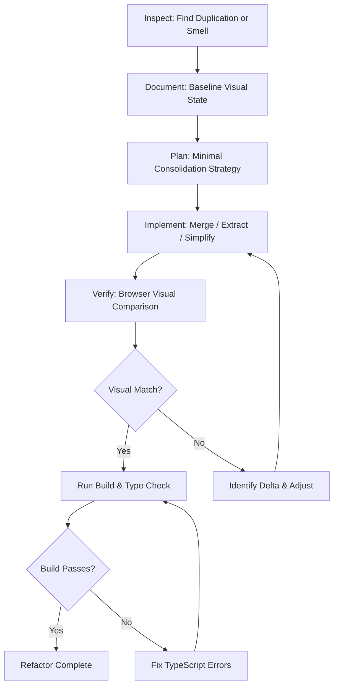

# Frontend Refactoring Workflow

Safe, structured consolidation of frontend code — without breaking existing visual output or introducing regressions.

---

## 1. The Refactoring Principle

Refactoring is a **behavior-preserving transformation**. When complete:
- The app looks identical to users (or better, if cleanup removes dead code that caused visual glitches)
- All tests pass
- The codebase is simpler: fewer files, less duplication, clearer component boundaries

If you are tempted to add features or improve visual design while refactoring, **stop and separate the concerns** — do the refactor first, verify it, then do the enhancement as a separate task.

---

## 2. The Safe Refactor Loop



---

## 3. Phase 1: Inspect — Finding What to Refactor

Before writing a single line of code, understand the full scope of the problem.

### Duplication Detection

```bash
# Find component files with similar names
find ZAP-FE/src -name "*.tsx" | sort

# Search for copied JSX patterns (e.g. duplicate button implementations)
grep -rn "className=\".*btn.*\"" ZAP-FE/src/components/ | head -30

# Identify repeated tailwind class strings (potential shared component candidate)
grep -rn "bg-slate-800 border border-slate-700" ZAP-FE/src/ | wc -l
```

### Common Refactoring Triggers

| Code Smell | Indicator | Refactor Action |
| :--- | :--- | :--- |
| **Duplicate component** | Two files with near-identical JSX and different names | Merge into single component with variant props |
| **Inline style repetition** | Same Tailwind class string in 5+ places | Extract to a shared Tailwind `@layer components` class or a wrapper component |
| **Prop drilling chains** | Prop passed through 3+ component layers | Lift to context or co-locate with nearest shared ancestor |
| **Monolith page component** | Single `page.tsx` with 400+ lines of JSX | Extract logical sections into sub-components in a co-located `components/` folder |
| **Dead code** | Commented-out JSX, unused imports, unreferenced exports | Remove safely after confirming `grep` finds zero usage sites |
| **Hardcoded API URLs** | `fetch("http://localhost:8000/api/...")` in component JSX | Move to `src/services/` or `src/api/` layer |
| **Mixed concerns** | UI state and business logic interleaved in same component | Extract custom hook for logic; keep component focused on rendering |

---

## 4. Phase 2: Baseline — Capture Current Visual State

Before any code change, record what the UI currently looks like. This is your regression target.

1. Start the dev server if not running.
2. Instruct the browser subagent:

```text
Navigate to [affected pages]. For each:
1. Capture a full-page screenshot at Desktop (1440x900).
2. Capture a screenshot at Mobile (375x812).
3. Note the exact rendered text, colors, and layout arrangement of the components I'm about to refactor.
4. Check DevTools console — record any existing errors (baseline noise, not regressions).
```

Save the screenshots conceptually as "Before" state. After refactoring, compare.

---

## 5. Phase 3: Plan — Minimal Consolidation Strategy

Write your plan before coding. For each identified smell:

1. **What is being consolidated?** (name the files/components)
2. **What is the new structure?** (name the output file, folder, props API)
3. **What must NOT change?** (visual output, event handlers, accessibility attributes)
4. **What is the migration path?** (find-replace import sites, update prop names)

**Example plan entry:**

```
Smell: AdminHeader.tsx and FacultyHeader.tsx are 95% identical.
New structure: src/components/PageHeader.tsx with `role: "admin" | "faculty"` prop.
Must not change: Same rendered title, same back-link behavior, same aria-label.
Migration: 2 import sites in /admin/layout.tsx and /faculty/layout.tsx.
```

Keep the plan minimal. If the plan touches more than 5 files, break it into two sequential refactors.

---

## 6. Phase 4: Implement

Apply changes in this order to minimize risk:

### Order of Operations

1. **Create the new shared component** in its target location
2. **Verify it renders correctly** by temporarily importing it in one usage site
3. **Migrate all usage sites** one by one (find with `grep -rn "OldComponent"`)
4. **Delete the old component** only after all import sites are updated
5. **Run `tsc --noEmit`** to confirm zero TypeScript errors before browser verification

### Implementation Rules

- Preserve all `aria-*` attributes, `data-testid` attributes, and keyboard event handlers from the original components — these are non-negotiable.
- When merging two components that have different prop shapes, design the unified prop interface first and derive both old shapes from it.
- Never change a component's exported name in the same commit that changes its implementation — rename in a separate step if needed.
- Don't reformat unrelated files. Git diff should show only the files the refactor touches.

---

## 7. Phase 5: Verify — Visual Regression Guard

After implementing, return to the browser and compare against baseline:

```text
Navigate to [affected pages]. For each:
1. Capture a full-page screenshot at Desktop (1440x900).
2. Capture a screenshot at Mobile (375x812).
3. Compare with baseline:
   - Same text content?
   - Same colors and layout?
   - Same interactive states (hover, focus, active)?
4. Interact with refactored components (click buttons, open modals, etc.)
   - Do they behave identically to before?
5. Check DevTools console for new errors that weren't in the baseline.
```

If any visual or behavioral delta is found, **do not ship** — go back to Phase 4 and adjust.

### Build Verification

```bash
# After visual confirmation, run the full build
npm run build --workspace=ZAP-FE

# If using Python backend
.venv/bin/pytest -v
```

Zero errors required before declaring the refactor done.

---

## 8. Refactoring Patterns Reference

### Extract Shared Component

```tsx
// Before: Duplicate in AdminCard.tsx and StudentCard.tsx
<div className="bg-slate-800 border border-slate-700 rounded-lg p-4">
  <h3 className="text-slate-100 text-sm font-semibold">{title}</h3>
</div>

// After: src/components/ui/Card.tsx
interface CardProps {
  title: string;
  children?: React.ReactNode;
  className?: string;
}
export function Card({ title, children, className }: CardProps) {
  return (
    <div className={cn("bg-slate-800 border border-slate-700 rounded-lg p-4", className)}>
      <h3 className="text-slate-100 text-sm font-semibold">{title}</h3>
      {children}
    </div>
  );
}
```

### Extract Custom Hook

```tsx
// Before: Data-fetching logic inline in QuestionPage.tsx
function QuestionPage() {
  const [questions, setQuestions] = useState([]);
  const [loading, setLoading] = useState(true);
  useEffect(() => {
    fetch("/api/v1/questions").then(r => r.json()).then(setQuestions).finally(() => setLoading(false));
  }, []);
  // 300 more lines of rendering...
}

// After: hooks/useQuestions.ts
export function useQuestions() {
  const [questions, setQuestions] = useState<Question[]>([]);
  const [loading, setLoading] = useState(true);
  useEffect(() => {
    fetch("/api/v1/questions").then(r => r.json()).then(setQuestions).finally(() => setLoading(false));
  }, []);
  return { questions, loading };
}

// QuestionPage.tsx becomes:
function QuestionPage() {
  const { questions, loading } = useQuestions();
  // Clean rendering only
}
```

### Consolidate Variant Components

```tsx
// Before: PrimaryButton.tsx + SecondaryButton.tsx + DangerButton.tsx
// After: Button.tsx with variant prop
type ButtonVariant = "primary" | "secondary" | "danger";
const variantStyles: Record<ButtonVariant, string> = {
  primary: "bg-blue-600 hover:bg-blue-500 text-white",
  secondary: "bg-slate-700 hover:bg-slate-600 text-slate-100",
  danger: "bg-rose-600 hover:bg-rose-500 text-white",
};
export function Button({ variant = "primary", ...props }: ButtonProps) {
  return <button className={cn("px-4 py-2 rounded-md text-sm font-medium", variantStyles[variant])} {...props} />;
}
```

---

## 9. Done Criteria

A refactor is complete when all of the following are true:

- [ ] No duplicate component files exist for the consolidated element
- [ ] All import sites have been updated and compile without errors
- [ ] Old files have been deleted (or stubbed as re-exports if public API stability is required)
- [ ] Browser visual comparison confirms identical rendering at Desktop and Mobile
- [ ] DevTools console shows no new errors introduced by the refactor
- [ ] `npm run build` exits with zero TypeScript errors
- [ ] `git diff --stat` shows only the files the refactor was scoped to touch
