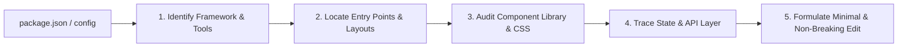

# Source-Code Analysis & Frontend Architecture Guidelines

Source-code inspection provides the blueprint of an application. Combining source-code analysis with live browser interaction ensures changes are architecturally sound, type-safe, and visually cohesive.

---

## 1. Project Manifest & Architecture Audit

Always inspect the project manifest before modifying or creating frontend files.

### Manifest Audit Checklist

1. **Core Framework**: React, Next.js, Vue, Nuxt, Svelte, SvelteKit, Angular, Astro.
2. **Styling Foundation**: Tailwind CSS, CSS Modules, Styled Components, Emotion, Vanilla CSS.
3. **UI & Icon Packs**: Lucide React (`lucide-react`), Radix UI (`@radix-ui/*`), Headless UI, Heroicons, Material UI, Shadcn UI.
4. **State Management**: React Context, Zustand, Redux Toolkit, Pinia, Recoil.
5. **Data Layer**: Fetch API, Axios, TanStack React Query, SWR, Server Actions.
6. **Code Editor / Specialized Libs**: `@monaco-editor/react`, Chart.js, Recharts, KaTeX.

---

## 2. Component Hierarchy & Layout Analysis

Identify the nesting structure of the application from the root to individual leaf views.

### Standard Layout Taxonomy

- **Root Shell (`layout.tsx` / `_app.tsx` / `App.vue`)**:
  - Contains `<html>`, `<body>`, global fonts, `ThemeProvider`, `AuthProvider`, and top-level toast/modal containers.
- **Nested Feature Shells (e.g. `src/app/admin/layout.tsx`)**:
  - Provides scoped navigation (e.g. `AdminHeader`, `Sidebar`, breadcrumbs) for a subset of routes.
- **Page Component (`page.tsx` / `+page.svelte`)**:
  - Responsible for route-specific data fetching, state aggregation, and composing UI organisms.
- **Organisms & Molecules (e.g. `src/components/*`)**:
  - Self-contained, reusable UI blocks (e.g. `StudentWorkspace`, `ContestArena`, `EditorPane`, `EnvironmentSwitcher`).
- **Atoms / Primitives**:
  - Fundamental interactive elements: Buttons, Inputs, Badges, Dropdowns, Toggles.

### Principles for Component Reuse vs. Duplication

> [!IMPORTANT]
> **Inspect Before You Create**:
> 1. Search `src/components/` for existing components before writing new JSX or TSX.
> 2. If a button, badge, modal, or input component already exists, **reuse and adapt it** via props instead of creating a parallel implementation.
> 3. Preserve the established design tokens and prop naming conventions (`variant`, `size`, `className`, `disabled`).

---

## 3. Styling & Design Token System

Examine how styles are applied across the project.

### Tailwind CSS Inspection (`tailwind.config.js`)

Check:
- Extended color palettes: `theme.extend.colors` (e.g. custom brand colors, slate tints, dark background tokens).
- Custom font families: `fontFamily: { sans: [...], mono: [...] }`.
- Border radius scales, custom shadows, and animations.
- Dark mode configuration: `darkMode: 'class'` (toggled via `.dark` on `<html>` or `<body>`).

### Global CSS Inspection (`globals.css`)

Check:
- CSS variables (e.g. `:root` and `.dark` variables like `--background`, `--foreground`, `--border`).
- Custom scrollbar rules, typography resets, and code block styling.
- Utility classes and component layers (`@layer components`, `@layer utilities`).

---

## 4. Application State & API Integration

Understand how data flows into pages to avoid breaking functional contracts.

### State & Event Architecture

- **Context Providers**:
  - Look for providers like `ThemeContext` (handling dark/light mode toggle) or `AuthContext` (managing student/faculty tokens).
- **Custom Event Buses**:
  - Look for window dispatch events like `window.dispatchEvent(new Event("ENVIRONMENT_CHANGE"))` or `AUTH_CHANGE_EVENT` (common in decoupled enterprise frontends).
- **Local Storage Keys**:
  - Identify persistent tokens (e.g. `zap_auth_student`, `zap_active_env`).

### API Layer & Endpoints

- Inspect `src/services/` or `src/api/` for centralized API clients.
- Verify how base URLs and environment toggles are resolved (e.g. `environment.ts`).
- Never hardcode API hostnames (`http://localhost:8000`) directly inside component JSX; always use the application's established service layer or environment abstraction.

---

## 5. Defensive Implementation & Safety Invariants

When modifying source code:
1. **Zero Unrelated Edits**: Do not touch unrelated files or reformat unaffected components.
2. **Preserve Logic & Accessibility**: Keep all `aria-*` tags, keyboard handlers (`onKeyDown`), and form submit semantics intact.
3. **Maintain Loose Coupling**: Follow architectural rules (e.g. in ZAP, question management and compiler execution must remain loosely coupled).
4. **Compile & Type Check**: Always run the build/type check (`npm run build --workspace=...` or `tsc --noEmit`) to verify zero TypeScript errors.
