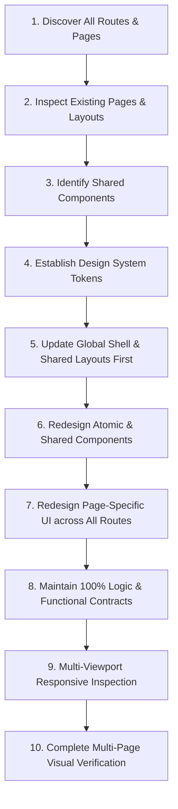

# UI/UX Design System & Website Redesign Guidelines

Creating professional, high-taste web interfaces requires intentional aesthetic decisions, strict typography standards, cohesive design tokens, and domain-grounded visual styling.

---

## 1. Eliminating "AI Slop" & Generic AI Tells

Generic AI-generated web designs look templated, repetitive, and uninspired. Actively avoid the following common tells:

| Cliché / AI Tell | Why It Degrades Quality | Professional Design Alternative |
| :--- | :--- | :--- |
| **SaaS-Card Kit Everywhere** | Every piece of information is chopped into identical rounded cards with soft gray shadows (`shadow-md`). | Varied visual structure: hairline dividing rules, clean lists, dense data tables, asymmetric layouts, borderless sections. |
| **Tracked-Out ALL-CAPS Eyebrows** | `UPPERCASE — SUBTITLE` slapped above every single heading. | Meaningful headings with typographic contrast; use eyebrows only when genuine categorical metadata is required. |
| **Random Neon Accents** | Electric cyan, neon green, or violent orange splashed across generic dark gray `#111` backgrounds. | Cohesive, purposeful palette: deep slate `#0b0f17`, refined indigo/blue `#3b82f6`, and functional semantic accents. |
| **Excessive Generic Motion** | Every card fades and slides up on scroll; bouncy hover animations on every element. | Subtle, purposeful micro-interactions (150ms-200ms transitions) that answer user actions (hover, active, expand). |
| **Lazy Placeholder Copy** | "Empower your workflow with cutting-edge AI solutions." | Domain-specific, authentic terminology (e.g. "DSA Problem Arena", "Monaco Code Execution Engine", "O(N log N) Runtime"). |

---

## 2. Establishing a Cohesive Design System

A high-taste web application is anchored by four systematic pillars: Color, Typography, Spatial Rhythm, and Micro-Interactions.

### A. Color Palette & Tokens (Dark-Mode First)

```
Background Deep:     #0b0f17  (Core application canvas)
Background Surface:  #111827  (Cards, sidebars, panes)
Background Elevated: #1e293b  (Dropdowns, popovers, active tabs)
Border Subtle:       #1e293b / #334155 (Crisp 1px hairlines)
Border Focus:        #3b82f6  (Intentional focus ring with outline-none)
Text Primary:        #f8fafc  (High-contrast crisp white/slate)
Text Secondary:      #94a3b8  (Muted metadata, labels)
Text Subtle:         #64748b  (Footnotes, inactive states)
```

**Semantic Accents**:
- **Easy / Success**: Emerald `#10b981` / `#059669` (Dark: text `#34d399`, bg `#10b981`/15, border `#10b981`/30)
- **Medium / Warning**: Amber `#f59e0b` / `#d97706` (Dark: text `#fbbf24`, bg `#f59e0b`/15, border `#f59e0b`/30)
- **Hard / Danger**: Rose `#f43f5e` / `#e11d48` (Dark: text `#fb7185`, bg `#f43f5e`/15, border `#f43f5e`/30)
- **Primary Action**: Blue `#2563eb` / `#3b82f6` (Dark: hover `#1d4ed8`, active `#1e40af`)

### B. Typography Hierarchy

- **Font Pairings**:
  - Sans-serif: `Inter`, system UI font for clean UI controls, navigation, and body copy.
  - Monospace: `JetBrains Mono`, `Fira Code`, or `ui-monospace` for code editors, complexity notations, parameters, and numeric metrics.
- **Scale**:
  - Hero / Display: `text-3xl font-bold tracking-tight` (30px / 36px line height)
  - Page Heading: `text-xl font-semibold text-slate-100` (20px / 28px line height)
  - Section Title: `text-base font-medium text-slate-200` (16px / 24px line height)
  - Body Text: `text-sm text-slate-400 leading-relaxed` (14px / 20px line height, max-w-prose < 80 chars)
  - Code / Metadata: `text-xs font-mono text-slate-300` (12px / 16px line height)

### C. Spatial Hierarchy & Hairlines

- Use **crisp 1px borders** (`border border-slate-800` or `border border-slate-700/60`) instead of heavy dropshadows.
- Maintain consistent spacing tokens: `gap-2` (8px), `gap-4` (16px), `gap-6` (24px).
- Group related controls with visual enclosures (e.g. segmented pills, button groups, unified toolbar headers).

---

## 3. Full Website Redesign Workflow

When a user requests a complete redesign of the website, execute this structured 10-step process. **Never redesign only the homepage.**



### Step-by-Step Execution Plan

1. **Discover All Relevant Routes**: Run `python3 scripts/discover_routes.py` to identify the full matrix of pages (e.g. `/`, `/admin`, `/login`, `/faculty/questions`, etc.).
2. **Inspect Existing Layouts**: Review `layout.tsx`, global navigation bars, footers, and sidebars.
3. **Identify Shared Components**: Isolate shared widgets (e.g. `ThemeToggle`, `AdminHeader`, `QuestionPane`, `EditorPane`, `EnvironmentSwitcher`).
4. **Establish Consistent Tokens**: Update or extend `tailwind.config.js` and `globals.css` with unified color variables and spacing.
5. **Update Shared Layout First**: Modernize root navigation, header bars, and responsive wrappers so all pages inherit a unified frame.
6. **Modernize Core Reusable Components**: Update buttons, tabs, search bars, and card containers.
7. **Iterate Page-Specific UI**: Progressively apply the design system to each discovered page:
   - Homepage / Dashboard
   - Question / Contest Arenas
   - Admin & Faculty Management Hubs
   - Auth & Settings Views
8. **Preserve All Existing Functionality**: Retain state variables, click handlers, form validation, and API hooks. Do not break working logic.
9. **Responsive Audit**: Verify desktop (1440px), tablet (768px), and mobile (375px) viewports on all touched pages.
10. **Multi-Page Visual Verification**: Use the Antigravity Browser Subagent to visit every redesigned route, capture screenshots, and verify visual harmony.

---

## 4. Multi-Agent Parallelism for Large Redesigns

When redesigning a site with 4+ pages, spawn parallel browser subagents to verify multiple routes simultaneously — this cuts verification time significantly.

```
Spawn in same turn:
  Browser Subagent A → verify / and /login
  Browser Subagent B → verify /admin and /admin/users
  Browser Subagent C → verify /admin/questions and /faculty/questions/new
```

**Protocol:**
1. After implementing code changes, identify all affected routes from the ephemeral inventory.
2. Group into batches of 2–3 routes.
3. Spawn one browser subagent per batch in the **same `invoke_subagent` turn**.
4. Collect all reports, merge findings, and address any failures.
5. Re-verify only the failed routes in a follow-up pass.

This pattern is appropriate for full-site redesigns. For single-page or small-scope changes, a single sequential browser session is sufficient.

---

## 5. Anti-Patterns to Avoid in Redesigns

Beyond the "AI Slop" table in section 1, watch for these common pitfalls during implementation:

| Anti-Pattern | Problem | Fix |
| :--- | :--- | :--- |
| **Hardcoded pixel widths** | Breaks at non-standard screen sizes | Use responsive Tailwind classes (`w-full`, `max-w-screen-lg`) |
| **`overflow: hidden` on body** | Prevents scroll on mobile, hides keyboard-expanded content | Use `overflow-x-hidden` only on specific containers where needed |
| **`!important` overrides** | Creates specificity wars that break in dark mode or component variants | Restructure class ordering or use `cn()` / `clsx()` merge utilities |
| **Removing focus styles** | Breaks keyboard accessibility | Keep `focus-visible:ring-*` on all interactive elements |
| **Font size < 16px on inputs** | Triggers iOS zoom on focus | Use `text-base` (16px) minimum on all `<input>` and `<select>` elements |
| **Fixed `z-index` without system** | Random collisions with modals and sticky headers | Use the z-index token ladder: sticky=10, dropdown=20, header=30, drawer=40, modal=50 |
