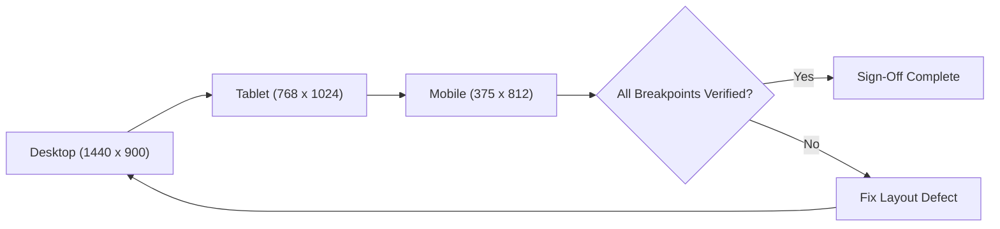

# Multi-Viewport Visual & Functional Verification Guidelines

Verification is the final and most critical gate before declaring any frontend task complete. Never assume changes work without inspecting rendered output in the browser.

---

## 1. The Core Verification Invariant

> [!CAUTION]
> **A successful build (`npm run build`, `npm test`, or `pytest`) does NOT mean the UI has been verified.**
> Compilers only verify syntax and type contracts; they cannot detect visual clipping, layout shifts, unresponsive breakpoints, broken contrast, or unclickable elements.
> **Visual and functional verification in the live browser is mandatory.**

---

## 2. Multi-Viewport Testing Matrix

Verify every affected page and component across three standardized viewport tiers:

### Viewport Specifications & Checks

| Viewport Category | Resolution (W x H) | Crucial Inspection Focus |
| :--- | :--- | :--- |
| **Desktop** | `1440 x 900 px` | Multi-column layouts, Monaco editor split views, persistent sidebars, dense data tables, toolbars. |
| **Tablet** | `768 x 1024 px` | Responsive collapse of sidebars into icons or drawers, card wrapping, touch-target sizing (minimum 44x44px). |
| **Mobile** | `375 x 812 px` | Single-column stacking, collapsible hamburger menu, zero horizontal overflow (`scrollWidth <= innerWidth`), form usability. |

---

## 3. Visual Verification Inspection Checklist

When inspecting pages with the Antigravity Browser Subagent, systematically audit the following seven criteria:

### 1. Horizontal Overflow Audit
- Execute check: Does the page allow horizontal panning on mobile?
- Rule: **Zero unwanted horizontal scrollbars**. All containers must fit within the 375px viewport boundary.
- If overflow occurs, inspect for unconstrained `w-screen`, unpadded `<pre>`/`<code>` blocks, or fixed pixel widths.

### 2. Header & Navigation Responsiveness
- Verify that wide desktop navbars smoothly transition into accessible mobile menus.
- Ensure the mobile menu trigger (hamburger button) is easily clickable and reveals all primary site links.
- Confirm menu closes automatically upon link navigation.

### 3. Typography & Readability
- Verify line lengths for prose and question descriptions do not exceed 80 characters (`max-w-prose` or `max-w-3xl`).
- Check that headings and titles do not clip or wrap into single orphan letters.
- Verify text contrast meets WCAG AA standards (minimum 4.5:1 against dark `#0b0f17` or light `#f8fafc` backgrounds).

### 4. Interactive States & Feedback
- Hover states: Subtle color change or glow on interactive buttons and links.
- Focus-visible: Distinct, high-contrast focus rings (`focus-visible:ring-2 focus-visible:ring-blue-500`) for keyboard accessibility.
- Active states: Visual depression or color shift on click.
- Disabled states: `opacity-50 cursor-not-allowed` on invalid buttons.

### 5. Form & Input Usability
- Form inputs must have legible placeholder text and clear label associations.
- Verify validation messages appear clearly when required fields are omitted.
- Confirm submit buttons display loading spinners (`Loader2` animated icon) while asynchronous API requests are in flight.

### 6. Modals, Drawers & Overlays
- Centered horizontally and vertically across desktop and mobile screens.
- Backdrop darkened (`bg-black/60 backdrop-blur-sm`) to occlude background noise.
- Dismissible via 'X' close button, clicking the backdrop, or pressing the Escape key.
- Internal scrolling enabled if modal content exceeds viewport height.

### 7. DevTools Console & Network Health
- DevTools console must be free of unhandled JavaScript exceptions, `404` resource errors, and React key/hydration warnings.
- All primary API requests must return HTTP 200/201 status codes.

---

## 4. Verification Sign-Off Protocol

Before finalizing any task and delivering results to the user:

1. **Capture Screenshot**: Take a visual snapshot of the primary affected views at Desktop and Mobile resolutions.
2. **Review Runtime Inventory**: Update the ephemeral inventory to mark inspected pages as `Verified`.
3. **Run Build Verification**: Execute `npm run build --workspace=ZAP-FE` (or project equivalent) to ensure type check passes.
4. **Deliver Transparent Summary**: Detail what was tested, which viewports were verified, and any remaining environment boundaries (e.g. backend auth gates).
