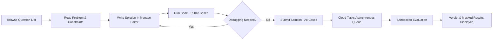

# 01. Project Overview: ZAP Platform

## 1. Executive Summary & Vision
**ZAP** is a high-performance, cloud-native online judge, competitive programming, and technical interview preparation platform (similar to LeetCode, Codeforces, and HackerRank). 

The platform is engineered to deliver:
- **Instantaneous Feedback**: Low-latency code execution across multiple programming languages.
- **Cost-Optimized Cloud Efficiency**: Scale-to-zero serverless architecture on GCP Cloud Run that eliminates permanent idle compute costs.
- **Multi-Tenant Runtime Flexibility**: Seamless dynamic routing between Production and QA environments within a single unified deployment.
- **Decoupled Architecture**: Complete separation of concern between pedagogical problem management and untrusted sandboxed code execution.

---

## 2. Target Audience & User Personas

| Persona | Primary Needs & Jobs to Be Done | Key Experience Expectations |
|---|---|---|
| **Student / Candidate** | Practice DSA problems, write code in preferred language, test against sample cases, submit for full evaluation. | Fast turnaround (< 2s on runs), zero lag Monaco editor, clear verdict diagnostics (WA, TLE, MLE, CE). |
| **Faculty / Interviewer** | Author problem statements, configure starter templates, create public & hidden test cases, review candidate performance. | Intuitive authoring dashboard, multi-language template generation, secure hidden test case storage. |
| **DevOps / Platform Admin** | Monitor platform health, manage cloud costs, inspect Cloud Tasks queues, run load testing simulations. | Complete observability, scale-to-zero efficiency, isolated lower-environment verification. |

---

## 3. Core Product Flows

### 3.1 Interactive Coding & Playground
- Student selects a problem from `/` (filtered by difficulty: `Easy`, `Medium`, `Hard`, or tag: `Array`, `Dynamic Programming`, etc.).
- The student selects a language (`Python`, `JavaScript`, `Java`, `C++`, `C`).
- Code editor loads pre-populated starter template with standardized solution class/method signatures.
- **Run Action**: Executes solution against public sample test cases for rapid local debugging.

### 3.2 Formal Solution Evaluation
- **Submit Action**: Submits code to the asynchronous evaluation pipeline.
- Job is dispatched via GCP Cloud Tasks to `zap-executor`.
- Evaluated against both `PUBLIC` and `HIDDEN` test cases.
- **Masking Security**: Hidden test inputs and expected outputs are never exposed in student API responses.

### 3.3 Faculty Question Authoring
- Accessible via `/faculty/questions` and `/faculty/questions/new`.
- Enables defining title, slug, markdown description, constraints, starter templates, and test cases.
- Provides test-case visibility toggling (`PUBLIC` vs `HIDDEN`).

---

## 4. Boundaries: Explicit In-Scope vs. Out-of-Scope

### ✅ In-Scope (Core Platform Capabilities)
- Multi-language code execution: Python 3.14, Node.js (JavaScript), Java 21, C++23, C.
- LeetCode-style automated driver harness and input parsing.
- Asynchronous task queuing via Google Cloud Tasks.
- Sandboxed execution with memory bounds, timeouts, and process limits.
- Multi-tenant runtime switching via `X-ZAP-ENV` header (`production` vs `qa`).
- Monaco Editor integration with auto-complete and dark mode.
- Comprehensive load testing suite with headless Locust simulation.

### ❌ Out-of-Scope / Non-Goals (Defending Against Scope Creep)
- **Monolithic In-Process Code Execution**: Student code will *never* be compiled or run inside the main `zap-api` process.
- **Heavy Distributed Microservices**: Do not split into dozens of microservices until scaling metrics mandate it. Keep the clean 2-service model (`zap-api` + `zap-executor`).
- **Premature Blockchain / Web3 Integrations**: No crypto rewards or decentralized storage.
- **Custom Hardware / Bare Metal Clusters**: The platform is explicitly architected for GCP Cloud Run and serverless containers.
- **Bypassing Sandbox Security**: No raw shell access, network access, or filesystem access is granted to student code during evaluation.

