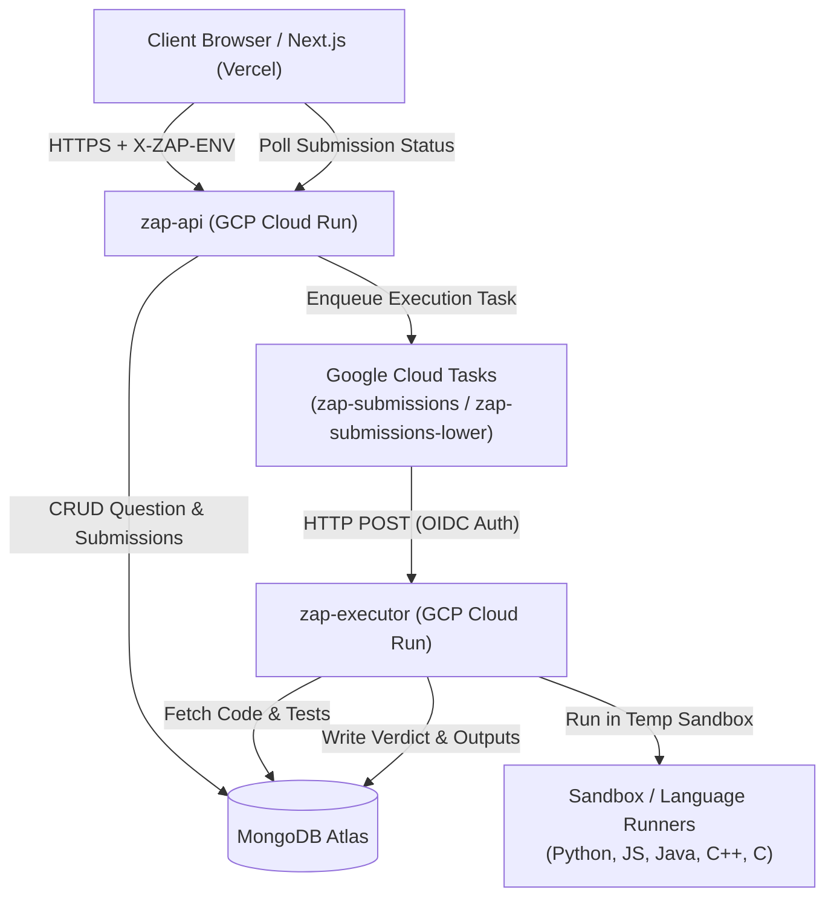
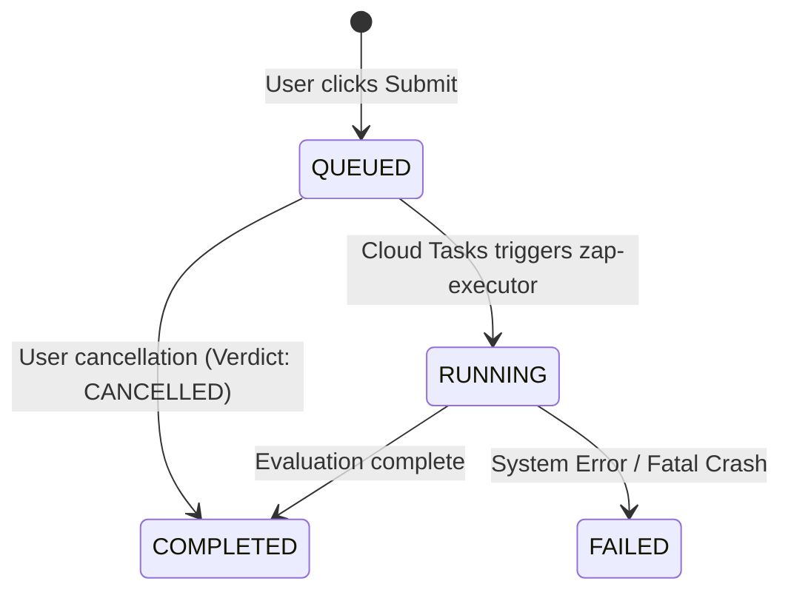

# 02. Architecture & System Design: ZAP Platform

## 1. Monorepo Layout & Service Boundaries

```text
zap/
├── context/                 # Six-File Context System (Primary Knowledge Base)
├── .agents/                 # Antigravity IDE rules, skills, and verification scripts
│   ├── rules/               # Rule hooks mapping to context files
│   └── skills/              # "build" & "frontend-design" skills
├── docs/                    # Deep-dive technical documentation
├── ZAP-BE/                  # Backend & Execution Subsystem (Python / FastAPI)
│   ├── app/                 # zap-api service (Questions, Submissions, Auth, DB)
│   ├── executor/            # zap-executor service (Sandboxed Runners, Harness, Judge)
│   ├── tests/               # Pytest test suite (60+ unit & integration tests)
│   ├── Dockerfile.api       # Container image for zap-api
│   └── Dockerfile.executor-api # Container image for zap-executor
├── ZAP-FE/                  # Frontend Web Application (Next.js 15, React 19, Tailwind, Monaco)
│   └── src/
│       ├── app/             # App Router pages (Arena, Faculty portal, Auth)
│       ├── components/      # UI components (Monaco Editor, Panels, TestRunner)
│       ├── services/        # API clients with X-ZAP-ENV header injection
│       └── types/           # Shared TypeScript interfaces
└── load_test/               # Locust load test suite with safe QA environment targeting
```

---

## 2. High-Level System Topology



---

## 3. Strict Architectural Invariants

Every engineer and AI agent working on ZAP **must adhere to these 5 non-negotiable invariants**:

### Invariant 1: Strict Loose Coupling Boundary
- **Question Management (`ZAP-BE/app/questions`)**:
  - Owns problem descriptions, difficulty, constraints, hints, tags, starter templates, and test case datasets.
  - Must NOT contain compiler flags, sandbox commands, or language runner logic.
- **Compiler / Executor Subsystem (`ZAP-BE/executor`)**:
  - Accepts only generic payloads: `sourceCode`, `language`, and `testCases` (`input`, `expectedOutput`, `visibility`).
  - Must NOT know question IDs, problem-specific domain logic, user scores, or contest rules.
  - The executor is a completely domain-agnostic computation engine.

### Invariant 2: Untrusted Code Isolation
- Student-submitted code is untrusted and potentially malicious.
- Untrusted code is **never** executed inside the main `zap-api` container.
- Code execution is exclusively delegated to `zap-executor`, which executes scripts within isolated child processes with:
  - Strict wall-clock and CPU time limits (e.g. 2.0s–5.0s depending on language).
  - Memory caps (e.g. 256MB–512MB).
  - Ephemeral scratch directories deleted immediately after evaluation.

### Invariant 3: Single Deployment, Multi-Tenant Runtime Routing
Instead of running duplicate infrastructure per branch or environment, ZAP maintains a single unified deployment on GCP Cloud Run with dynamic runtime routing via request headers:

| Layer | Production Environment | QA / Testing Environment |
|---|---|---|
| **Header** | `X-ZAP-ENV: production` (or omitted) | `X-ZAP-ENV: qa` |
| **Database** | MongoDB `zap_platform_prod` | MongoDB `zap_platform_lower` |
| **Task Queue** | Cloud Tasks `zap-submissions` | Cloud Tasks `zap-submissions-lower` |
| **Compute** | Shared `zap-api` & `zap-executor` | Shared `zap-api` & `zap-executor` |

### Invariant 4: Asynchronous Processing for Full Submissions
- Interactive **Run** requests for public sample tests may execute synchronously or via fast worker pools for quick feedback.
- Formal **Submit** requests for the full test suite (including hidden tests) **must always be asynchronous**:
  1. `zap-api` records the submission in MongoDB with status `QUEUED`.
  2. `zap-api` enqueues an authenticated Cloud Task pointing to `zap-executor /execute`.
  3. `zap-executor` updates status to `RUNNING`, executes test cases, computes verdict, and marks `COMPLETED` or `FAILED`.
  4. Frontend polls `GET /submissions/{id}` until terminal status is reached.

### Invariant 5: Test Case Security & Masking
- Hidden test cases are confidential to prevent reverse engineering and cheating.
- The `zap-api` submission endpoints **must mask** the inputs, outputs, and diffs of any test case marked `visibility: HIDDEN`.
- The user only receives:
  - Overall verdict (e.g., `WRONG_ANSWER`).
  - Total passed count (e.g., `42 / 50 test cases passed`).
  - Input/Output details for **public** test cases only.

---

## 4. Submission State Lifecycle & Verdict Hierarchy



### Verdict Severity Hierarchy
When evaluating multiple test cases, the final submission verdict reflects the highest severity outcome encountered:
$$\text{ACCEPTED} < \text{WRONG\_ANSWER} < \text{OUTPUT\_LIMIT\_EXCEEDED} < \text{TIME\_LIMIT\_EXCEEDED} < \text{RUNTIME\_ERROR} < \text{COMPILE\_ERROR}$$

---

## 5. Supported Language Runtimes

| Language | Identifier | Runtime Version | Execution Engine |
|---|---|---|---|
| **Python** | `python` | Python 3.14 | Direct interpreter in ephemeral sandbox |
| **JavaScript** | `node` | Node.js 20+ | V8 engine execution |
| **Java** | `java` | OpenJDK 21 | Headless single-source / compile-and-run |
| **C++** | `cpp` | GCC / Clang (C++23) | `-O2 -std=c++23` compiled binary execution |
| **C** | `c` | GCC / Clang (C17/C23) | `-O2` compiled binary execution |

