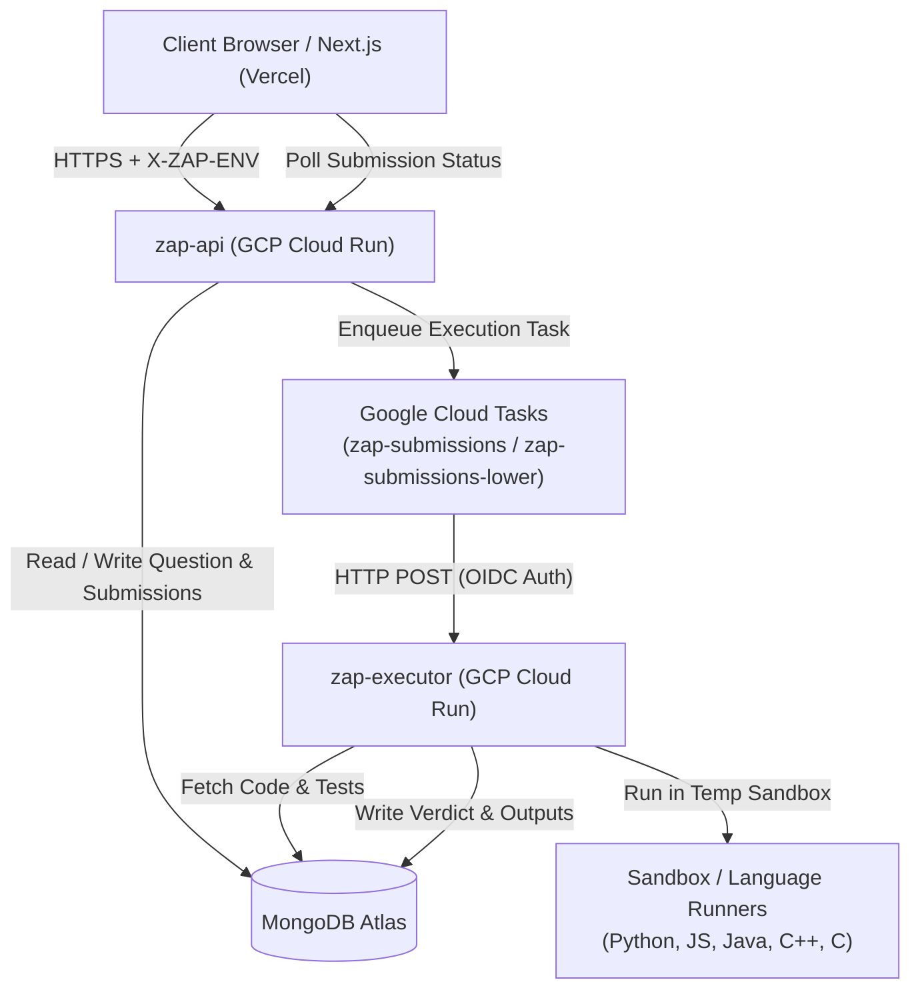

# ZAP Platform Documentation

Welcome to **ZAP** (DSA & Technical Interview Preparation Platform).

ZAP provides an online code execution and competitive programming environment designed for high concurrency, low idle cost, and decoupled problem management.

---

## 🏛️ Core Architectural Principles

1. **Loose Coupling**: The Question Management system (metadata, problem statements, test cases) and the Code Execution Compiler are strictly separated. The compiler receives code, language, and test cases without domain knowledge of questions.
2. **Untrusted Code Isolation**: Student code is never executed inside the main API. It runs inside an isolated, resource-constrained sandbox container (`zap-executor`).
3. **Single Deployment, Multi-Tenant Runtime**: A single codebase on `main` deploys one API service and one Executor service on GCP Cloud Run. Environment switching (`production` vs `qa`) is performed dynamically via request headers (`X-ZAP-ENV`), routing jobs to separate MongoDB databases and Cloud Tasks queues.
4. **Scale-to-Zero & Bursty Efficiency**: Cloud Run handles bursty coding session spikes while scaling to zero when idle, avoiding permanent idle server costs.

---

## 🧭 System Topology

---

## 📂 Hierarchical Documentation Index

To keep context token-efficient and informative for both AI agents and engineers, documentation is organized hierarchically:

| Category | Document | Description |
|---|---|---|
| **System Architecture** | [`docs/architecture/system-design.md`](file:///Users/apilav068@apac.comcast.com/zap/docs/architecture/system-design.md) | Monorepo layout, submission lifecycle, loose coupling contracts, and execution states. |
| **Backend & Database** | [`docs/backend/api-and-database.md`](file:///Users/apilav068@apac.comcast.com/zap/docs/backend/api-and-database.md) | FastAPI routing, MongoDB models (`questions`, `submissions`, `users`), auth, and multi-tenant environment routing. |
| **Compiler & Execution Engine** | [`docs/backend/compiler-engine.md`](file:///Users/apilav068@apac.comcast.com/zap/docs/backend/compiler-engine.md) | LeetCode-style auto-harness, sandbox isolation, judge engine, test case masking, and supported languages. |
| **Frontend Application** | [`docs/frontend/architecture.md`](file:///Users/apilav068@apac.comcast.com/zap/docs/frontend/architecture.md) | Next.js 15, React 19, Monaco Editor integration, student problem workspace, faculty manager, and env switcher. |
| **Cloud Infrastructure & CI/CD** | [`docs/infrastructure/cloud-and-pipeline.md`](file:///Users/apilav068@apac.comcast.com/zap/docs/infrastructure/cloud-and-pipeline.md) | GCP Cloud Run, Cloud Tasks, Secret Manager, Workload Identity, and GitHub Actions CD deployment pipeline. |
| **Local Development** | [`docs/development/local-setup.md`](file:///Users/apilav068@apac.comcast.com/zap/docs/development/local-setup.md) | Local environment bootstrap, mock MongoDB / queue fallbacks, pytest, and frontend build commands. |

---

## ⚡ Quick Reference

- **Frontend Host**: Vercel (`codezap-arena.vercel.app`, `run.codezap.in`, `codezap.in`)
- **Backend API**: GCP Cloud Run (`https://zap-api-394729648143.us-central1.run.app`)
- **Executor Service**: GCP Cloud Run (`https://zap-executor-394729648143.us-central1.run.app` - Private/OIDC only)
- **Supported Languages**: Python 3.14 (`python`), JavaScript (`node`), Java 21 (`java`), C++23 (`cpp`), C (`c`)
- **Database**: MongoDB Atlas (`zap_platform_prod` for Production, `zap_platform_lower` for QA)
- **Queue**: Google Cloud Tasks (`zap-submissions` for Production, `zap-submissions-lower` for QA)
