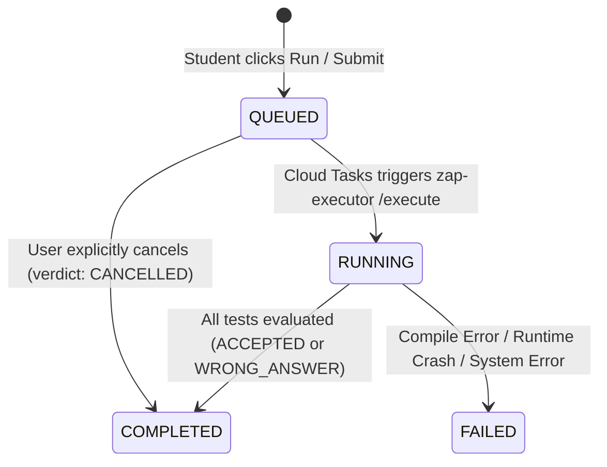

# ZAP System Design & Architecture

## 1. Monorepo Structure

```text
zap/
├── .agents/                 # Antigravity IDE custom skills & rules
│   ├── rules/               # Architecture & workflow guidelines
│   └── skills/              # "build" & "frontend-design" skills
├── .github/workflows/       # GitHub Actions CI/CD deployment pipeline
├── docs/                    # Hierarchical technical documentation
├── ZAP-BE/                  # Backend & Compiler Execution Subsystem (Python / FastAPI)
│   ├── app/                 # FastAPI REST API (Questions, Submissions, Auth, DB)
│   ├── executor/            # Isolated Sandboxed Execution Engine (Runners, Judge, Cloud Tasks handler)
│   ├── tests/               # Pytest integration & unit test suite
│   ├── Dockerfile.api       # Container definition for zap-api
│   └── Dockerfile.executor-api # Container definition for zap-executor
└── ZAP-FE/                  # Frontend Web Application (Next.js 15, React 19, Tailwind, Monaco)
    └── src/
        ├── app/             # App Router pages (Student playground, Faculty dashboard)
        ├── components/      # UI components (Monaco Editor, QuestionView, OutputPanel)
        ├── services/        # API clients with X-ZAP-ENV header propagation
        └── types/           # Shared TypeScript interfaces
```

---

## 2. Loose Coupling Boundary

The system maintains a strict architectural boundary between **Question Management** and **Compiler Execution**:

- **Question Management (`app/questions`)**:
  - Owns problem descriptions, difficulty, constraints, hints, tags, starter templates, and test case datasets.
  - Does NOT know how code is compiled or sandboxed.
- **Compiler Subsystem (`executor/`)**:
  - Receives only generic execution requests: `sourceCode`, `language`, and an array of `testCases` (`input`, `expectedOutput`, `visibility`).
  - Does NOT know question IDs, business logic, user streaks, or problem metadata.
  - Reusable for competitive programming, interview assessments, course homework, or playground scratchpads.

---

## 3. Submission Lifecycle



### Modes of Execution
1. **`RUN` Mode**:
   - Executes code only against visible public sample test cases (or custom stdin).
   - Fast turnaround for interactive debugging.
2. **`SUBMIT` Mode**:
   - Executes code against the complete test case suite (both `PUBLIC` and `HIDDEN`).
   - Masks hidden test case inputs and expected outputs in API responses to prevent cheating.
   - Computes formal verdict and test pass count (`X / Y passed`).

### Verdict Hierarchy
When multiple tests fail, the final verdict reflects the highest severity status:
`ACCEPTED` < `WRONG_ANSWER` < `OUTPUT_LIMIT_EXCEEDED` < `TIME_LIMIT_EXCEEDED` < `RUNTIME_ERROR` < `COMPILE_ERROR`.

---

## 4. Single Deployment Multi-Tenant Architecture

Instead of duplicating cloud deployments per branch, ZAP uses a **single deployment with runtime context switching**:

| Component | Production | QA |
|---|---|---|
| **Frontend UI Switcher** | Default | Toggle in header (`localStorage.setItem('zap.environment', 'qa')`) |
| **HTTP Request Header** | `X-ZAP-ENV: production` | `X-ZAP-ENV: qa` |
| **MongoDB Database** | `zap_platform_prod` | `zap_platform_lower` |
| **Cloud Tasks Queue** | `zap-submissions` | `zap-submissions-lower` |
| **Cloud Run Services** | `zap-api` & `zap-executor` (Shared) | `zap-api` & `zap-executor` (Shared) |

The executor receives `payload.environment` in the Cloud Task body, ensuring it writes execution results back to the matching environment database.
