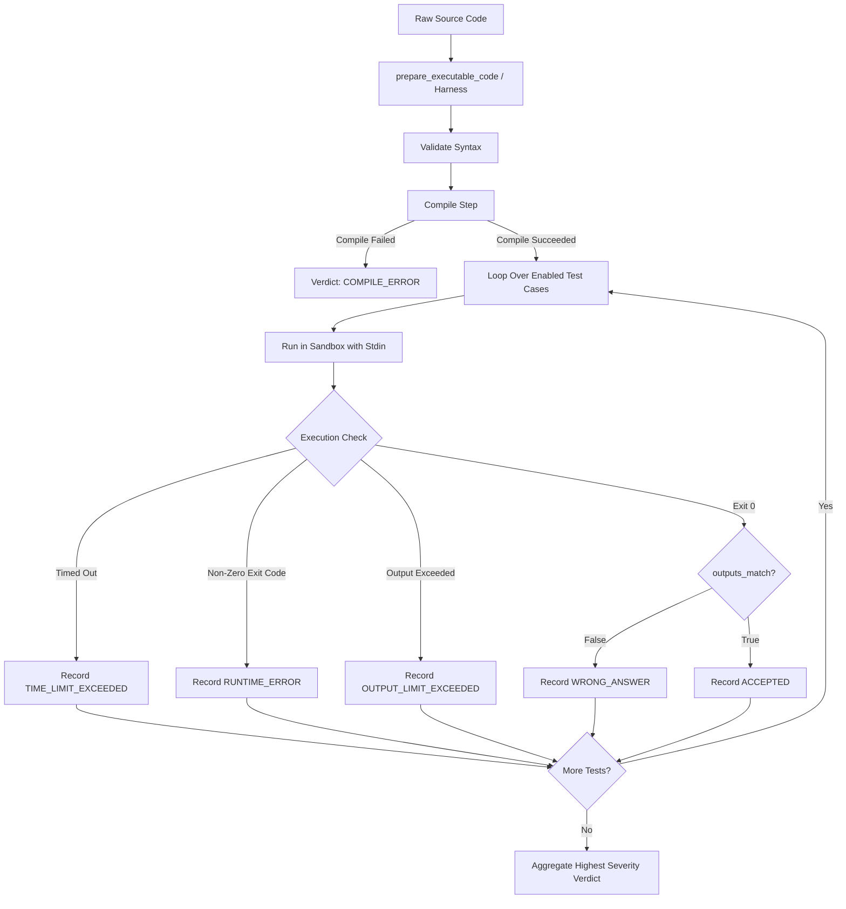

# ZAP Compiler & Execution Engine

The compiler subsystem (`ZAP-BE/executor`) is a standalone, sandboxed code execution and automated grading engine.

---

## 1. Supported Languages & Toolchains

| Language | Identifier | Compiler / Interpreter | Runtime Command |
|---|---|---|---|
| **Python** | `python`, `py`, `python3` | Python 3.11 / 3.14 | `python3 solution.py` |
| **Node.js** | `node`, `js`, `javascript` | Node.js 20+ / 22+ | `node solution.js` |
| **Java** | `java` | OpenJDK 21 | `javac Solution.java` ➔ `java Solution` |
| **C++** | `cpp`, `c++` | GCC / G++ (C++23) | `g++ -O3 -std=c++23 solution.cpp -o solution` |
| **C** | `c` | GCC (C17 / C2x) | `gcc -O3 solution.c -o solution` |

---

## 2. LeetCode-Style Auto-Harness (`executor/core/harness.py`)

ZAP allows students to submit either standard standalone scripts (with `main()`) or LeetCode-style solution classes/functions.

### 2.1 How the Harness Works
1. **Comment Stripping**: Removes comments and docstrings before signature detection to prevent false-positive matching.
2. **Signature Detection**: Parses method signatures (e.g. `def twoSum(self, nums: List[int], target: int) -> List[int]:`).
3. **Data Structure Injection**: Automatically injects common interview definitions like `ListNode` and `TreeNode` for tree/linked-list problems.
4. **I/O Driver Generation**: Generates a runtime wrapper that reads stdin (line-delimited or JSON parameters), converts types, invokes the user's method, serializes the return value, and writes it to stdout.
5. **Backwards Compatibility**: If user code already defines its own entrypoint (e.g. `if __name__ == '__main__':` or `int main()`), the harness passes the code through unmodified.

### 2.2 Intelligent Output Matching (`outputs_match`)
Output comparison does not rely on naive string matching. It intelligently recognizes:
- **Booleans**: `true` vs `True` vs `false` vs `False`.
- **JSON Arrays**: `[0, 1]` matches `[0,1]`.
- **Token Equivalence**: Space-delimited outputs (`"0 1"`) match array format (`"[0, 1]"`).
- **Quoted Strings**: `"abc"` matches `abc`.
- **Whitespace Normalization**: Trailing whitespaces and line-ending variances (`\r\n` vs `\n`) are stripped.

---

## 3. Sandboxing & Containment (`executor/sandbox/sandbox.py`)

Untrusted code runs under strict operational constraints:

- **Isolated Workspace**: Each submission executes inside an ephemeral directory:
  `/tmp/zap/submissions/<submission_id>/` with subdirectories for `source`, `build`, `stdin`, `stdout`, `stderr`.
- **Sanitized Environment**: System environment variables are stripped. Only safe essentials (`PATH`, `LANG`, `LC_ALL`, `USER`, `HOME`, `TERM`) are passed to child processes. Application secrets and MongoDB connection strings are NEVER exposed to student code.
- **Resource Constraints**:
  - **Timeout**: Enforced via `subprocess.Popen(timeout=...)` (default 5.0s per test case). Subprocesses exceeding limits are sent `SIGKILL`.
  - **Output Size Cap**: Maximum 1MB (`1024 * 1024` bytes) per test case. Oversized outputs are truncated and trigger `OUTPUT_LIMIT_EXCEEDED`.
  - **Cleanup**: `Sandbox.cleanup()` recursively purges the workspace directory immediately after execution completes.

---

## 4. Judge Engine (`executor/judge/judge.py`)

The `JudgeEngine` coordinates the end-to-end evaluation:

### Privacy & Anti-Cheating
- `PUBLIC` test cases reveal `input`, `expectedOutput`, and `actualOutput` on failure.
- `HIDDEN` test cases return `passed: boolean`, execution timing, and status, but mask `input`, `expectedOutput`, and `actualOutput` as `null` in the API response.

---

## 5. Cloud Tasks Consumer (`executor/tasks/handler.py`)

In production, the executor runs as an HTTP service receiving jobs dispatched by Google Cloud Tasks (`POST /internal/tasks/execute`):

1. **OIDC Authentication**: Validates Google Cloud Tasks bearer token signature against `TASKS_OIDC_AUDIENCE` and `TASKS_SERVICE_ACCOUNT`.
2. **Atomic Claiming**: Uses MongoDB `find_one_and_update` to transition status from `QUEUED` to `RUNNING`. If a duplicate task arrives, it is safely acknowledged.
3. **Database Resolution**: Reads `payload.environment` to connect to `zap_platform_prod` or `zap_platform_lower`.
4. **Execution & Persistence**: Evaluates the submission using `JudgeEngine` and updates MongoDB with the final verdict and test summaries.
