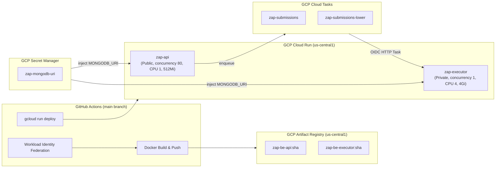
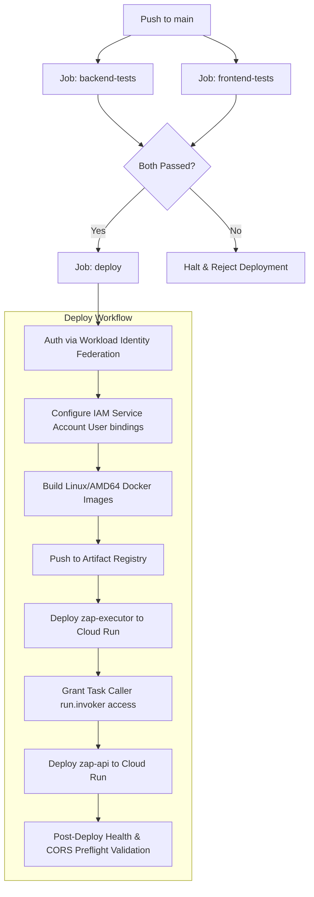

# ZAP Cloud Infrastructure & CI/CD Pipeline

ZAP runs entirely on managed serverless infrastructure on **Google Cloud Platform (GCP)** and **Vercel**, orchestrated by an automated **GitHub Actions** deployment pipeline.

---

## 1. GCP Cloud Topology

---

## 2. Infrastructure Components Specification

### 2.1 GCP Project & Identity
- **Project ID**: `zap-platform-prod`
- **Project Number**: `394729648143`
- **Region**: `us-central1`
- **Artifact Registry**: `zap-images` (`us-central1-docker.pkg.dev/zap-platform-prod/zap-images`)

### 2.2 Service Accounts & IAM Roles
| Service Account | Identifier | Responsibilities |
|---|---|---|
| **Deployer** | `zap-github-deployer@...` | Authenticated via Workload Identity Pool (`github-actions/providers/zap-repository`) to build, push images, and deploy services. |
| **API Runtime** | `zap-api-runtime@...` | Runs `zap-api`. Holds `cloudtasks.enqueuer` permission on both queues. |
| **Task Caller** | `zap-tasks-invoker@...` | Attached to Cloud Tasks HTTP tasks. Granted `roles/run.invoker` to invoke `zap-executor`. |
| **Executor Runtime** | `zap-executor-runtime@...` | Runs `zap-executor` with sandboxed non-root user `runner` (uid 2000). |

### 2.3 Cloud Run Services
- **`zap-api`**:
  - URL: `https://zap-api-394729648143.us-central1.run.app`
  - Access: Public (`--allow-unauthenticated`).
  - Sizing: CPU 1, Memory 512Mi, Concurrency 80, Scale `0 → 20`.
- **`zap-executor`**:
  - URL: `https://zap-executor-394729648143.us-central1.run.app`
  - Access: Private (`--no-allow-unauthenticated`). Only invocable by `zap-tasks-invoker`.
  - Sizing: CPU 4, Memory 4Gi, Concurrency 1 (strictly isolated one submission execution per container instance), Scale `0 → 5`, Request timeout 360s.

### 2.4 Cloud Tasks Queues
- **Production Queue**: `zap-submissions`
- **QA Queue**: `zap-submissions-lower`

### 2.5 Secret Management
- Secret `zap-mongodb-uri` in GCP Secret Manager stores the MongoDB Atlas cluster connection string.
- Bound at deployment time via `--update-secrets="MONGODB_URI=zap-mongodb-uri:latest"`.

---

## 3. CI/CD Deployment Pipeline (`.github/workflows/ci.yml`)

Every push to `main` runs automated test suites followed by atomic deployment:

### Deployment Verification Gates
The pipeline terminates with automated validation checks:
1. `curl --fail $API_URL/health` ➔ validates API health.
2. `curl -X OPTIONS $API_URL/api/v1/submissions` with Vercel Origin ➔ verifies CORS preflight returns 200 OK.
3. `gcloud tasks queues describe` ➔ validates queues are active.
4. `gcloud run services describe zap-executor` ➔ validates `Ready` condition is True.
