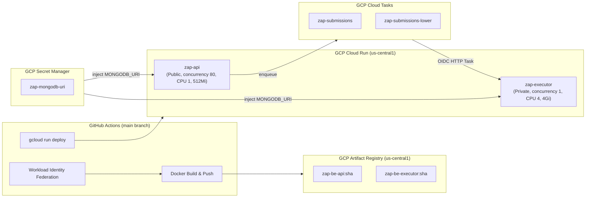

# ZAP Cloud Infrastructure & CI/CD Pipeline

ZAP runs entirely on managed serverless infrastructure on **Google Cloud Platform (GCP)** and **Vercel**, orchestrated by an automated **GitHub Actions** deployment pipeline.

---

## 1. GCP Cloud Topology



---

## 2. Infrastructure Components Specification

### 2.1 GCP Project & Identity
- **Project ID**: `zap-platform-prod`
- **Project Number**: `394729648143`
- **Region**: `us-central1`
- **Artifact Registry**: `zap-images` (`us-central1-docker.pkg.dev/zap-platform-prod/zap-images`)

### 2.2 Service Accounts & IAM Roles
| Service Account | Identifier | Responsibilities |
|---|---|---|
| **Deployer** | `zap-github-deployer@...` | Authenticated via Workload Identity Pool (`github-actions/providers/zap-repository`) to build, push images, and deploy services. |
| **API Runtime** | `zap-api-runtime@...` | Runs `zap-api`. Holds `cloudtasks.enqueuer` permission on both queues. |
| **Task Caller** | `zap-tasks-invoker@...` | Attached to Cloud Tasks HTTP tasks. Granted `roles/run.invoker` to invoke `zap-executor`. |
| **Executor Runtime** | `zap-executor-runtime@...` | Runs `zap-executor` with sandboxed non-root user `runner` (uid 2000). |

### 2.3 Cloud Run Services
- **`zap-api`**:
  - URL: `https://zap-api-394729648143.us-central1.run.app`
  - Access: Public (`--allow-unauthenticated`).
  - Sizing: CPU 1, Memory 512Mi, Concurrency 80, Scale `0 → 20`.
- **`zap-executor`**:
  - URL: `https://zap-executor-394729648143.us-central1.run.app`
  - Access: Private (`--no-allow-unauthenticated`). Only invocable by `zap-tasks-invoker`.
  - Sizing: CPU 4, Memory 4Gi, Concurrency 1 (strictly isolated one submission execution per container instance), Scale `0 → 5`, Request timeout 360s.

### 2.4 Cloud Tasks Queues
- **Production Queue**: `zap-submissions`
- **QA Queue**: `zap-submissions-lower`

### 2.5 Secret Management
- Secret `zap-mongodb-uri` in GCP Secret Manager stores the MongoDB Atlas cluster connection string.
- Bound at deployment time via `--update-secrets="MONGODB_URI=zap-mongodb-uri:latest"`.

---

## 3. CI/CD Deployment Pipeline (`.github/workflows/ci.yml`)

The deployment pipeline is optimized for efficiency and minimal resource usage using **path filtering** and **selective execution**:

```mermaid
flowchart TD
    A[Git Push / PR] --> B{Path Filter}
    B -- "Only docs / markdown / .agents" --> C[Workflow Skipped Completely]
    B -- "Code or Pipeline Changes" --> D[Job: detect-changes]

    D --> E{What Changed?}

    E -- "Backend Changed (ZAP-BE, pytest.ini)" --> F[Job: backend-tests]
    E -- "Frontend Changed (ZAP-FE, package*.json)" --> G[Job: frontend-tests]
    E -- "Pipeline or Shared (workflows, env)" --> F & G

    F --> H{Backend Tests Pass & Branch == main?}
    H -- Yes --> I[Job: deploy (Cloud Run)]
    H -- No --> J[Halt & Reject Deployment]

    subgraph DeployJob["GCP Cloud Run Deploy Workflow"]
        I1[Auth via Workload Identity Federation]
        I2[Configure IAM Service Account User bindings]
        I3[Build Linux/AMD64 Docker Images]
        I4[Push to Artifact Registry]
        I5[Deploy zap-executor to Cloud Run]
        I6[Grant Task Caller run.invoker access]
        I7[Deploy zap-api to Cloud Run]
        I8[Post-Deploy Health & CORS Preflight Validation]
    end

    I --> I1 --> I2 --> I3 --> I4 --> I5 --> I6 --> I7 --> I8
```

### 3.1 Path Filtering Rules

1. **Skipped Files (`paths-ignore`)**:
   - `docs/**`, `**/*.md`, `AGENTS.md`, `README.md`
   - `.agents/**`, `.claude/**`, `.issues/**`
   - `.gitignore`, `.vscode/**`, `.idea/**`
   - Pushes or PRs modifying *only* these paths do not trigger GitHub Actions runs at all, consuming 0 runner minutes.

2. **Selective Component Detection (`detect-changes` Job)**:
   - **Backend (`backend: true`)**: Triggered by changes to `ZAP-BE/**`, `pytest.ini`, `.github/workflows/**`, `.env*`.
   - **Frontend (`frontend: true`)**: Triggered by changes to `ZAP-FE/**`, root `package.json`, `package-lock.json`, `.github/workflows/**`, `.env*`.
   - **Selective Execution**:
     - If only Frontend changes: `frontend-tests` runs; `backend-tests` and `deploy` are skipped.
     - If only Backend changes: `backend-tests` runs, and `deploy` runs; `frontend-tests` is skipped.
     - If both change (or workflow / shared files change): Both test suites run and `deploy` executes.

3. **Manual Trigger (`workflow_dispatch`)**:
   - Includes a `target` selection input:
     - `auto` (default): Detects changes from commit history.
     - `all`: Forces both frontend & backend test suites and backend deployment.
     - `backend`: Runs backend tests and deployment only.
     - `frontend`: Runs frontend tests only.

### 3.2 Vercel Frontend Deployment Optimization

Vercel deploys the frontend web app automatically on push to `main`. To prevent Vercel from rebuilding when only backend or documentation changes:

- In **Vercel Project Settings ➔ Git ➔ Ignored Build Step**, set:
  ```bash
  git diff --quiet HEAD^ HEAD ./ZAP-FE
  ```
- When the command exits with `0` (no changes in `ZAP-FE`), Vercel automatically skips the build, saving build minutes and deployment bandwidth.

### 3.3 Deployment Verification Gates
The backend deployment terminates with automated validation checks:
1. `curl --fail $API_URL/health` ➔ validates API health.
2. `curl -X OPTIONS $API_URL/api/v1/submissions` with Vercel Origin ➔ verifies CORS preflight returns 200 OK.
3. `gcloud tasks queues describe` ➔ validates queues are active.
4. `gcloud run services describe zap-executor` ➔ validates `Ready` condition is True.
